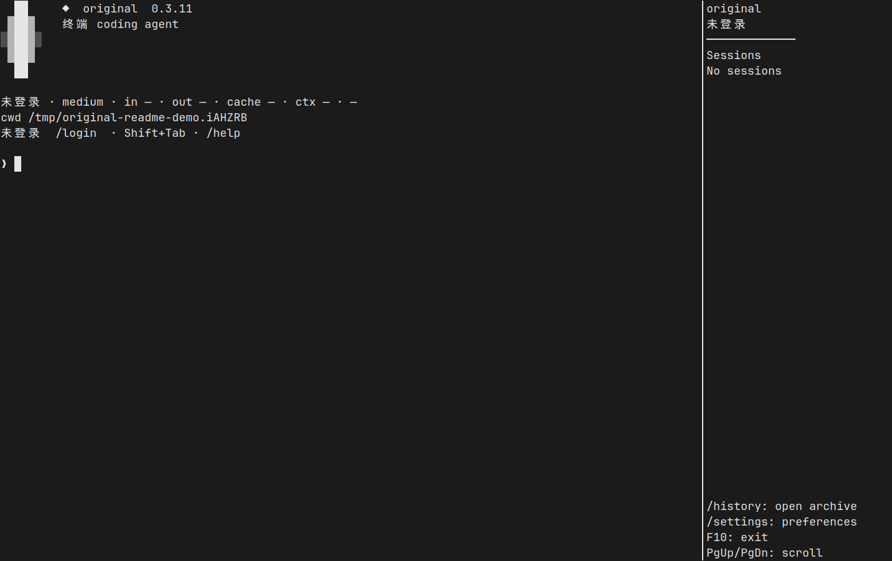
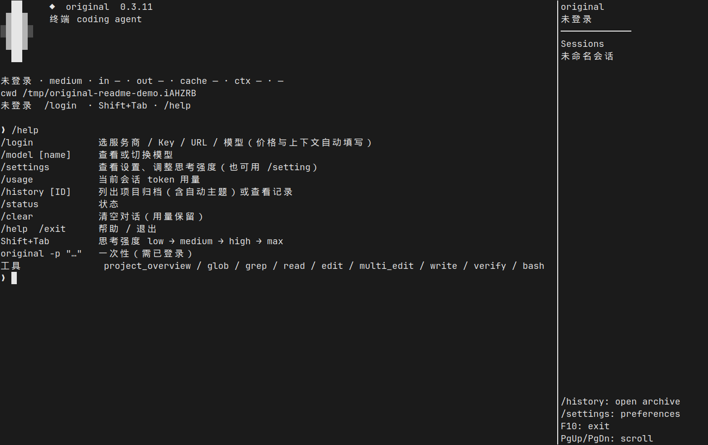

# original-agent

[](https://github.com/haoranyoung09-sys/original-agent/blob/main/.github/workflows/ci.yml)
[](https://github.com/haoranyoung09-sys/original-agent/actions/workflows/ci.yml)
[](https://github.com/haoranyoung09-sys/original-agent/releases/latest)
[](LICENSE)

[简体中文](README.md) · **English** · [日本語](README.ja.md) · [한국어](README.ko.md)

Explore code, edit files, and run project tests from the terminal. Original is a Rust coding agent with Anthropic and OpenAI-compatible backends, in-process file undo, and local session archives. The interaction draws on [Pi](https://github.com/badlogic/pi-mono).

This source is package version `0.3.11`. `original --version`, `Cargo.toml`, and tag `v0.3.11` use that same number. The older tag `v0.3.10` still points at package `0.3.9`. The release workflow requires the tag and package version to match, so `v0.3.10` has no prebuilt assets.

The four badges read this repository. They do not claim downloads or coverage:

- **Rust 1.100.0 stable** is the Rust logo plus the toolchain text. `Cargo.toml` has no `rust-version`, and the repository declares no MSRV. `1.100.0` is the stable toolchain `rustup` resolved on 2026-11-12. CI and the release workflow install the floating channel `dtolnay/rust-toolchain@stable`; that channel is not a minimum supported version.
- **CI** is the latest result of [`.github/workflows/ci.yml`](.github/workflows/ci.yml) on `main`.
- **release** is the newest GitHub Release. When this page was written, that release was `v0.3.9`. Assets for package `0.3.11` appear in the badge only after that tag's release workflow uploads them.
- **license** is the repository license, currently [MIT](LICENSE).

## Start here

1. [Install](#installation). Use the installer when Rust is not available, or `cargo install --locked --tag v0.3.11` for this source.
2. Run `original`, then `/login`. The program cannot call a model before login.
3. An interactive terminal starts full screen. `original --classic` uses the line interface.

## Interface

These pictures and the short recording are desktop screenshots of one real run of the release binary `original` 0.3.11. They are not mockups and not a redraw of terminal text. The capture used an empty temporary home and an empty temporary working directory. There was no login, no API key, and no model call. The `/tmp/original-readme-demo.*` path in the picture is that empty directory. The first sidebar text is the program's own `No sessions`. After `/help`, the sidebar shows the not-yet-named local archive `未命名会话`.





Seven-second screen recording of the same keystrokes: [fullscreen-help.mp4](docs/assets/fullscreen-help.mp4). Reproduce it with [docs/assets/capture-readme-demo.sh](docs/assets/capture-readme-demo.sh) after `cargo build --locked --release`, on a machine with a display, xfce4-terminal, xdotool, and ffmpeg.

## Full-screen terminal

Interactive startup enters the full-screen host only when `--classic` and `--subscription` are absent, there is no `-p` or positional prompt, and both stdin and stdout are terminals. At 110 columns or more, a fixed gray 28-column session index appears on the right and hides on narrower terminals. The model name is one line and the thinking effort is the next line, so a long model name cannot cover it. The index is not clickable; open an archive with `/history ID`. Page Up and Page Down move about ten scrollback lines, and any other key returns to the live view. F10 exits the host. The window title while it runs is `original`.

The host runs this same program inside an embedded terminal. Login, settings, and per-command approval stay line prompts. The input prompt is a colored `❯` that scrolls with the conversation. It does not show the model or effort. Those appear in the startup subtitle, the status line (`model · effort`), and the sidebar. `original --classic`, one-shot mode, official CLI handoff, and non-terminal stdin or stdout use the line interface directly.

## Installation

The no-Rust installers download GitHub Release assets and verify SHA-256. The checksum is not an independent code signature. When this file was written, the newest Release that already contained Windows x64, Linux x64, macOS Intel, and macOS Apple Silicon assets was `v0.3.9`. Assets for `v0.3.11` exist only after the release workflow for that tag uploads them. A missing asset aborts installation and does not replace an existing binary.

Windows x64, PowerShell. Run `iex (irm …)` as one expression:

```powershell
iex (irm https://raw.githubusercontent.com/haoranyoung09-sys/original-agent/main/scripts/install.ps1)
```

Pin a version:

```powershell
& ([scriptblock]::Create((irm https://raw.githubusercontent.com/haoranyoung09-sys/original-agent/main/scripts/install.ps1))) -Version v0.3.11
```

Without `iex`:

```powershell
Invoke-WebRequest -UseBasicParsing -Uri https://raw.githubusercontent.com/haoranyoung09-sys/original-agent/main/scripts/install.ps1 -OutFile $env:TEMP\original-install.ps1
powershell -NoProfile -ExecutionPolicy Bypass -File $env:TEMP\original-install.ps1
```

Linux x64 / macOS Intel or Apple Silicon:

```sh
curl -fsSL https://raw.githubusercontent.com/haoranyoung09-sys/original-agent/main/scripts/install.sh | sh
# pin a version after downloading the script
sh install.sh v0.3.11
```

Windows x64 installs `%USERPROFILE%\.original-agent\bin\original.exe` and updates the user PATH, including the current PowerShell session. Reopen other terminals. Unix installs `~/.local/bin/original` and prints an `export` line when that directory is not on `PATH`. Linux binaries are built on Ubuntu 22.04, need a compatible glibc, and use the system OpenSSL through native-tls. The macOS and Windows builds do not.

Update by running the same installer again. On Windows, quit a running `original.exe` first: a locked file aborts the copy and leaves the previous binary in place. After `cargo build --locked --release`, `scripts/install-from-local-build.ps1` copies the local Windows binary, and `scripts/package-local-release.ps1` writes a directory that `install.ps1 -BaseUrl` can verify. `ORIGINAL_INSTALL_BASE` can point at a local asset directory.

### Install from source

Stable Rust and the platform build tools are required. The crate is not published to crates.io.

```sh
cargo install --locked --git https://github.com/haoranyoung09-sys/original-agent --tag v0.3.11 original-agent
original --version
```

From a checkout: `cargo install --locked --path . --force`. Windows can run `scripts/install-original.ps1`; Unix can run `sh scripts/install-original.sh`. The Cargo bin directory must be on `PATH`. `cargo install --offline` works when the dependencies are already cached.

Maintainers publish by pushing a `v*` tag equal to `Cargo.toml`. The release workflow checks that name, then builds the four platform assets and their `.sha256` files. Do not move an existing tag or create a second release for it.

## Architecture

This is a standalone Rust 2021 terminal application. It is not an official Rust port of Pi and it is not affiliated with Anthropic, OpenAI, or Google.

- Tokio runs async work, Clap parses arguments, and Rustyline edits lines. The full-screen host uses crossterm, portable-pty, and vt100.
- Anthropic Messages uses community SDK [claudius](https://github.com/rescrv/claudius) 0.33.0 in [vendor/claudius](vendor/claudius). It is not an official Anthropic Rust SDK. Local patches cover Windows builds and untagged custom-tool schemas.
- OpenAI-compatible Chat Completions uses reqwest and Serde. Requests set `stream: true`. A JSON `Content-Type` is read as one JSON body. There is no Responses API backend.
- Shared tools read, write, edit, multi-edit, glob, literal grep, summarize a project, and verify. `changes.rs` keeps in-process snapshots and `archive.rs` stores session files.

| Module | Responsibility |
| --- | --- |
| `src/main.rs`, `src/ui.rs`, `src/terminal.rs` | Startup, line UI, full-screen host |
| `src/agent.rs`, `src/openai_client.rs` | Provider calls |
| `src/tools.rs`, `src/tool_dispatch.rs`, `src/fsops.rs` | Shared tools and file operations |
| `src/changes.rs`, `src/archive.rs` | Undo snapshots and session archives |
| `src/subscription.rs` | Handoff to an installed official CLI |

## Model compatibility

These are implemented presets, not a claim that every model was tested with a live account. The program does not bundle a local model runtime. It does not download, start, or embed Ollama or Gemma.

| Provider | Preset or integration | Notes |
| --- | --- | --- |
| Anthropic | `claude-sonnet-4-20250514`, Messages | Other model IDs can be configured, but thinking and tool parameters must be accepted by that service |
| OpenAI | `gpt-4.1`, Chat Completions | Models that need another protocol are not switched automatically |
| DeepSeek | The menu offers both Anthropic-compatible `https://api.deepseek.com/anthropic` and OpenAI-compatible `https://api.deepseek.com`, each defaulting to `deepseek-flash` | `/model` fills catalog IDs such as `deepseek-v4-pro` |
| xAI / Grok | Custom OpenAI-compatible URL `https://api.x.ai/v1` | No subscription OAuth and no xAI prices in the catalog. `--subscription grok` returns unsupported |
| Gemini | Official Gemini CLI handoff | No native Gemini API backend |
| Custom providers | Separate menu entries for custom Anthropic-compatible and custom OpenAI-compatible | The next prompt asks only for the URL. The model is `my-model`, the context window is 128000, and there are no prices. Use HTTPS, or HTTP only for `localhost`, `127.0.0.1`, or `[::1]`. Credentials, queries, and fragments are rejected |
| A server you already run | No bundled runtime | Put its OpenAI-compatible URL in the custom OpenAI preset. This program does not provide embedded inference |

Prices and context windows come from the snapshot in `src/model_catalog.rs`, reviewed 2026-11-06, not from a live provider page. `/login` stores the preset model, context window, and input/output prices. A cache-read price is stored only when the catalog has one. `/model <name>` overwrites those fields for a known ID and keeps the current values, with a note, for an unknown ID. Official CLI handoff is not priced with this catalog.

## Authentication

### API mode

Run `original`, enter `/login`, and choose API. Arrow keys move, Enter confirms, and Esc cancels. The menu needs an interactive terminal and lists Anthropic, OpenAI, DeepSeek Anthropic-compatible, DeepSeek OpenAI-compatible, custom Anthropic-compatible, and custom OpenAI-compatible. The API key is masked with `*`. An empty key keeps the saved key. Changing the base URL clears it first. Configuration is `~/.original-agent/config.json`. Saved keys are plaintext, written with mode `0o600` on Unix.

The first non-empty value wins among `ORIGINAL_API_KEY`, `ANTHROPIC_API_KEY`, `OPENAI_API_KEY`, `DEEPSEEK_API_KEY`, and `CLAUDIUS_API_KEY`. The lookup does not follow the selected provider. A `.env` file in the user config directory is loaded. A project `.env` is not.

### Official client handoff

Install the official CLI and put it on `PATH`, then run one of:

```sh
original --subscription codex
original --subscription claude
original --subscription gemini
```

or choose subscription inside `/login`. The official client owns login, permissions, sessions, and billing. This does not expose subscription models inside original. No browser cookies or official credential caches are copied. `--allow-shell` does not apply after the handoff. `original --subscription …` returns before the user-config `.env` is loaded. Choosing subscription from `/login` after the REPL has started inherits variables already loaded from that file. Neither path reads a project `.env`.

## Working directory and commands

```sh
original --cwd /path/to/project
original -p "explain the project structure"
original explain the project structure
original --classic
original --allow-shell
original --auto-verify
original --show-tools
original --show-thinking
```

`-p` wins when both it and positional text are present. One-shot mode needs a saved config or an API key in the environment, and it does not enter the full-screen host.

- `--cwd <path>` is resolved from the process current directory, must exist, and is canonicalized. It skips the Git-root walk.
- Without `--cwd`, the workspace is the nearest ancestor containing `.git`, or the current directory when none exists. Starting in a repository subdirectory roots file tools at the Git root. There is no home-directory project picker.
- Full-screen and classic modes use the same rule. `--subscription` uses that directory and does not open another menu.
- File tools cannot leave the workspace. The end of an interactive turn lists file-tool paths and Git-visible unstaged or untracked changes. Without Git, only file-tool records are listed.

| Command | Behavior |
| --- | --- |
| `/login` | Choose API or subscription, then a provider and API key |
| `/model`, `/model <name>` | Show or switch the model and apply a known catalog entry |
| `/settings`, `/setting`, `/config` | Show model, effort, timeout, and auto-verify; change effort |
| `/status` | Model, usage, and cost estimate |
| `/usage` | Token counters for this session |
| Shift+Tab | Cycle and save low, medium, high, max |
| `/history`, `/history ID` | List archives for this workspace, or open one |
| `/sessions`, `/session show <id>` | Compact list, or open one archive |
| `/export` | Write `summary.md` beside the current archive |
| `/diff` | Show full-file diffs recorded by file tools |
| `/undo`, `/undo all` | Undo the latest recorded batch, or every recorded batch |
| `/clear` | Clear the conversation and keep cumulative usage |
| `/help`, `/?`, `/exit`, `/quit` | Help and exit |

Shift+Tab and `/settings` store the names low, medium, high, and max. The `❯` prompt has one fixed color. It does not turn white, green, magenta, or red as effort changes. Anthropic requests include adaptive thinking configuration and send the level as `output_config.effort`. OpenAI-compatible requests do not send `reasoning_effort`, so the local level does not change that request body. A non-empty `NO_COLOR` disables ANSI color in the main interface. An empty value does not. Tool status turns color off whenever the variable is set.

## Tools, approval, verification, and errors

Workspace file reads and writes are allowed by default. Tool logs are hidden unless `--show-tools` is set. That switch shows the tool name, path or command, elapsed time, and success or failure. Colored shell status also requires a terminal.

Without `--allow-shell`, model `bash`, model `verify`, and automatic verification ask for the directory and command in the terminal. `y` or `yes` allows that one command. An empty or other answer denies it. Denial, or a session that cannot prompt, returns exit code 126 and text telling the model to use `--allow-shell`. There is no dialog. Non-interactive stdin or stderr cannot prompt, so those runs need `--allow-shell`. With `--allow-shell`, confirmation is skipped and the model can run arbitrary commands as your user. Read [SECURITY.md](SECURITY.md) first.

Shared tools are `project_overview`, `glob`, `grep`, `read`, `edit`, `write`, `multi_edit`, `verify`, and `bash`. Without authorization, `verify` only suggests a command.

`original --auto-verify` is separate from `--allow-shell`. It runs one detected project command: `Cargo.toml` → `cargo test --locked`, `package.json` → `npm test --silent`, `pyproject.toml` or `pytest.ini` → `python -m pytest -q`, `go.mod` → `go test ./...`. Those commands execute repository code. In an interactive session, verification runs when this turn recorded a file-tool edit or Git reports a new unstaged or untracked change. On failure, shortened stdout and stderr go back to the model for at most three repair turns. A repair turn with no new workspace change stops the loop. If no project command is detected, the program prints that and continues. One-shot mode verifies once and does not ask for a repair. A missing command or a non-zero test makes the process fail.

`--command-timeout` defaults to 600 seconds and accepts 1–600. It caps shell commands and automatic verification. It does not change the HTTP timeout. The OpenAI-compatible client times out HTTP after 300 seconds. Status `429`, `500`, `502`, `503`, and `504`, plus connect, timeout, and request errors, are retried up to three more times using exponential backoff or a `Retry-After` value capped at 30 seconds. Other HTTP failures print the status and body. Malformed tool-argument JSON is returned to the model as error text in the tool result. Login failure, a missing API key, and a failed model call are terminal text. There is no API, key, or model error popup.

`--show-thinking` prints thinking text only when the provider returns it: Anthropic thinking blocks after a response, or streamed `reasoning_content` on the OpenAI-compatible path. The program does not invent thinking text. The switch defaults to off.

DOCX and PPTX reads and writes need Python 3 plus `python-docx` and `python-pptx`. PNG, JPEG, BMP, and TIFF reads call Tesseract on `PATH` with `chi_sim+eng`. If those programs are missing, that file operation fails with text.

## Default prices

USD per 1M tokens, reviewed 2026-11-06. Provider bills control the actual charge. The table lists the three built-in preset defaults.

| Model | Context | Input | Output |
| --- | ---: | ---: | ---: |
| Claude Sonnet 4 | 200,000 | 3 | 15 |
| GPT-4.1 | 1,047,576 | 2 | 8 |
| DeepSeek Flash | 1,000,000 | 0.30 | 1.20 |

DeepSeek estimates use peak rates. Off-peak rates are about half. Cache discounts may be incomplete. Unknown models can still be selected, but the cost estimate may be empty or wrong.

## Undo and archives

`/diff` shows full-file replacement diffs recorded in this process, not minimal unified diffs. `/undo` and `/undo all` restore file-tool snapshots only and refuse a file that changed outside those tools. Snapshots live in memory and disappear on exit. They do not cover shell or official CLI edits. A failed batch write attempts rollback and reports a failed rollback. It is not a crash-safe transaction. An I/O error during undo can stop midway.

Archives default to `~/.original-agent/sessions/<timestamp-id>/` with `metadata.json` and `events.jsonl`. The first substantial user message contributes its first sentence, shortened to the sidebar width, as `topic`. Later messages do not replace it. `/history` and the full-screen sidebar show that topic. Older archives fall back to the first user message, then to `未命名会话` when none exists. `/sessions` lists records whose saved cwd equals the current workspace. `/export` writes `summary.md`. `original --no-record` disables the archive for this run. Official CLI handoff does not archive.

Completed turns, error text, and verification command, exit code, output, and elapsed time are recorded. A crash can lose an in-progress turn. Login forms are excluded. Saved keys and authentication lines are redacted, but other secrets in arbitrary text may remain. Opening an archive does not resume the model conversation or restore files. There is no retention or delete command. Line-editing history is a separate file, `~/.original-agent/history`.

## Development and licensing

```sh
cargo fmt --check
cargo test --locked
cargo clippy --locked --all-targets
cargo build --locked --release
powershell -NoProfile -ExecutionPolicy Bypass -File scripts/test-installer.ps1
sh scripts/test-installer.sh
```

GitHub workflows cover Windows, Linux, and macOS, plus installer fixtures. Check the actual run rather than assuming every platform passed. Historical notes in [docs/archive](docs/archive) can describe older behavior.

The application uses [MIT](LICENSE). Vendored claudius uses Apache-2.0. See [third-party notices](THIRD_PARTY_NOTICES.md), [security notes](SECURITY.md), and [contribution guidelines](CONTRIBUTING.md).
