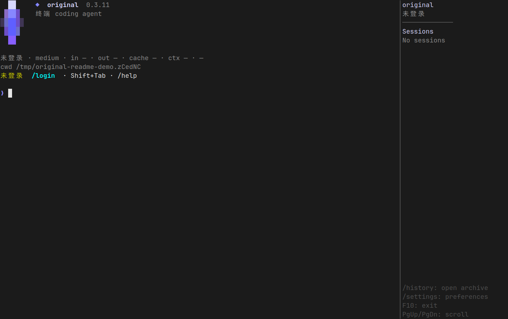
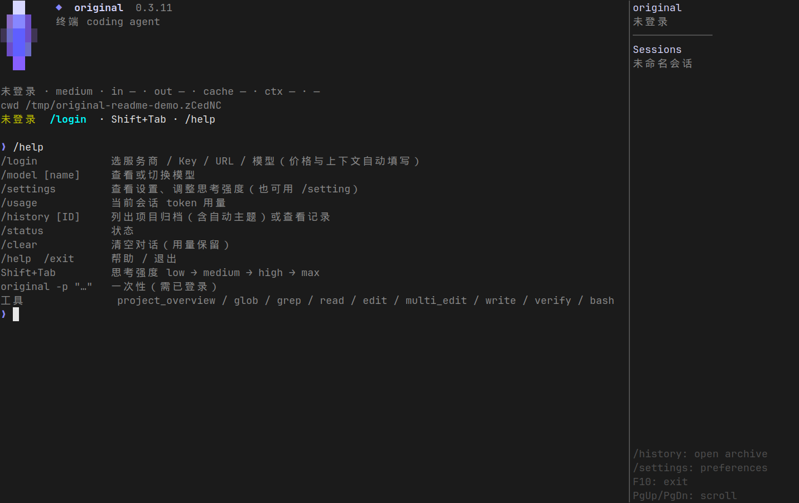

# original-agent

[](https://github.com/haoranyoung09-sys/original-agent/blob/main/.github/workflows/ci.yml)
[](https://github.com/haoranyoung09-sys/original-agent/actions/workflows/ci.yml)
[](https://github.com/haoranyoung09-sys/original-agent/releases/latest)
[](LICENSE)

[简体中文](README.md) · [English](README.en.md) · **日本語** · [한국어](README.ko.md)

Original は Rust 製のターミナル向けコーディングエージェントです。自然言語でコードを検索し、ファイルを編集し、プロジェクトのテストを実行できます。ファイルツールの変更をプロセス内で取り消し、セッションをローカルに保存します。画面の考え方は [Pi](https://github.com/badlogic/pi-mono) を参考にしています。Pi、Anthropic、OpenAI、Google の公式製品ではありません。

このソースのパッケージ版は `0.3.12` です。`original --version`、`Cargo.toml`、タグ `v0.3.12` は同じ番号です。公開済みのタグ `v0.3.11` は当時の README とデモのマージを指したままで、パッケージ版は `0.3.11` です。そのタグは動かさないでください。古いタグ `v0.3.10` のパッケージ版は `0.3.9` のままで、リリースワークフローはタグとパッケージ版の一致を要求するため、`v0.3.10` にはプリビルドの添付がありません。

バッジはすべてこのリポジトリの実データです。ダウンロード数やカバレッジは表示しません。

- **Rust 1.100.0 stable** は Rust のロゴとツールチェーンの文字です。`Cargo.toml` に `rust-version` は無く、MSRV も宣言していません。`1.100.0` は 2026-11-12 に `rustup` が解決した stable です。CI と Release は浮動チャンネル `dtolnay/rust-toolchain@stable` を入れます。これは最低対応バージョンではありません。
- **CI** は `main` の [`.github/workflows/ci.yml`](.github/workflows/ci.yml) の最新結果です。
- **release** は GitHub 上の最新 Release です。この文書の作成時点では `v0.3.11` で、四つのプラットフォームの添付が既にあります。パッケージ `0.3.12` の添付は、タグ `v0.3.12` の Release ワークフローがアップロードに成功してからこのバッジに出ます。
- **license** はリポジトリのライセンスで、現在は [MIT](LICENSE) です。

## 最初に見ること

1. [インストール](#インストールと更新)。Rust が無いときはインストールスクリプト、この版のソースは `cargo install --locked --tag v0.3.12` です。
2. `original` を起動して `/login` を入力します。ログイン前はモデルを呼び出せません。
3. 対話端末は全画面で始まります。`original --classic` は行単位の画面です。

## 画面

次の 2 枚と短い録画は、release ビルドの `original` 0.3.11 を実際に動かしたデスクトップのスクリーンショットです。左上の宝石はプログラム自身が送る 256 色で、塗りつぶし部分の画素は `#d7d7ff`、`#8787ff`、`#875fff`、`#5f5fff` です。撮影時は空でない `NO_COLOR` を外しています。この変数があると色が送られず、端末は既定の文字色で灰白に描きます。概念図でも、端末出力を描き直した図でもありません。空の一時ホームと空の一時作業ディレクトリを使い、ログインも API キーもモデル呼び出しもありません。画像内の `/tmp/original-readme-demo.*` はその空ディレクトリです。起動直後のサイドバーはプログラム自身の文言 `No sessions` です。`/help` のあと、まだ主題の無いローカル記録 `未命名会话` が表示されます。





同じ操作の 7 秒間の画面録画です: [fullscreen-help.mp4](docs/assets/fullscreen-help.mp4)。再現手順は [docs/assets/capture-readme-demo.sh](docs/assets/capture-readme-demo.sh) です。`cargo build --locked --release` のあと、ディスプレイ、xfce4-terminal、xdotool、ffmpeg がある環境で実行します。

## 全画面ターミナル

次の条件をすべて満たす対話起動だけが全画面ホストになります。`--classic` も `--subscription` もなく、`-p` も位置引数のプロンプトもなく、標準入力と標準出力がどちらも端末であること。幅が 110 列以上になると、右側に固定グレーの 28 列でセッション索引を出します。狭い画面では隠します。索引の 1 行目がモデル名、次の行が思考レベルです。長いモデル名で思考レベルが切れないように分けています。索引はクリックできません。記録を開くには `/history ID` を使います。Page Up / Page Down はスクロールバックを約 10 行動かし、それ以外のキーは現在の画面へ戻します。F10 でホストを終了します。実行中のウィンドウタイトルは `original` です。

ホストは同じプログラムを埋め込み端末で起動します。ログイン、設定、コマンドの都度確認は従来の行プロンプトです。入力は色付きの `❯` だけで、会話と一緒に上へ流れます。プロンプトの横にモデル名や思考レベルは出ません。起動時の副題、状態行（`モデル · 思考レベル`）、およびサイドバーに表示します。`original --classic`、一回限りの実行、公式 CLI への引き継ぎ、端末でない標準入出力は、全画面を使わず行インターフェースになります。

## インストールと更新

Rust なしのインストーラーは GitHub Release の添付をダウンロードし、SHA-256 を確認します。このチェックサムは独立したコード署名ではありません。この文書を書いた時点で、Windows x64、Linux x64、macOS Intel、macOS Apple Silicon の添付がある最新 Release は `v0.3.11` です。`v0.3.12` の添付は、そのタグが起動した Release ワークフローのアップロードが成功してから存在します。添付が無いときはインストールが失敗し、既存のバイナリは置き換えません。

Windows (PowerShell, x64)。`iex (irm …)` を一つの式として実行します。

```powershell
iex (irm https://raw.githubusercontent.com/haoranyoung09-sys/original-agent/main/scripts/install.ps1)
```

版を固定する:

```powershell
& ([scriptblock]::Create((irm https://raw.githubusercontent.com/haoranyoung09-sys/original-agent/main/scripts/install.ps1))) -Version v0.3.12
```

Linux x64 / macOS Intel または Apple Silicon:

```sh
curl -fsSL https://raw.githubusercontent.com/haoranyoung09-sys/original-agent/main/scripts/install.sh | sh
# スクリプトを保存してから版を固定
sh install.sh v0.3.12
```

Windows は x64 のみで、`%USERPROFILE%\.original-agent\bin\original.exe` に置き、ユーザー PATH を更新します。現在の PowerShell にも追加されますが、開いている他の端末は開き直してください。Unix は `~/.local/bin/original` に置き、PATH に無ければ `export` の案内を出します。Linux バイナリは Ubuntu 22.04 で構築され、互換 glibc と、native-tls 経由のシステム OpenSSL が必要です。macOS と Windows の添付はその OpenSSL を使いません。

更新は同じインストールコマンドを再実行します。Windows で `original.exe` が実行中だと上書きに失敗して中止し、元のファイルが残ります。Release を使わない場合は `cargo build --locked --release` のあと、Windows では `scripts/install-from-local-build.ps1`、または `scripts/package-local-release.ps1` で作ったディレクトリを `install.ps1 -BaseUrl` に渡せます。`ORIGINAL_INSTALL_BASE` もローカルな添付ディレクトリを指せます。

ソースから入れるには安定版 Rust と各 OS のビルドツールが必要です。crates.io には未公開です。

```sh
cargo install --locked --git https://github.com/haoranyoung09-sys/original-agent --tag v0.3.12 original-agent
original --version
```

チェックアウト済みの場合は `cargo install --locked --path . --force` です。Windows は `scripts/install-original.ps1`、Unix は `sh scripts/install-original.sh` も使えます。Cargo の bin ディレクトリを PATH に入れてください。依存関係がキャッシュ済みなら `--offline` を付けられます。

## ログイン、モデル、思考レベル

`/login` は上下キーで選び、Enter で確定、Esc で取り消します。対話端末が必要です。最初のメニューは中国語の `API`、`本地模型 (GGUF / llama-server，无需运行 Ollama)`、`订阅` です。API のメニューは次の 6 つです。Anthropic、OpenAI、DeepSeek（Anthropic 互換）、DeepSeek（OpenAI 互換）、カスタム Anthropic 互換、カスタム OpenAI 互換。API キーの入力は `*` で隠します。空のまま確定すると保存済みキーを残します。base URL が変わると、保存済みキーは先に消えます。設定は `~/.original-agent/config.json` で、キーは平文です。Unix では `0o600` で書きます。

| 接続 | 実装されている経路 |
| --- | --- |
| Anthropic | Messages API。既定モデル `claude-sonnet-4-20250514` |
| OpenAI | Chat Completions。既定モデル `gpt-4.1`。別プロトコルが必要なモデルへは自動では切り替えません |
| DeepSeek | メニューに Anthropic 互換 `https://api.deepseek.com/anthropic` と OpenAI 互換 `https://api.deepseek.com` の両方があります。既定モデルはどちらも `deepseek-flash` |
| xAI / Grok | カスタム OpenAI 互換に `https://api.x.ai/v1` を入れ、その後 `/model` でモデルを指定します。組み込みのサブスクリプション OAuth は無く、価格表にも xAI はありません。`--subscription grok` は未対応と返します |
| Gemini | 公式 Gemini CLI へ端末を渡します。ネイティブ Gemini API はありません |
| カスタム | API の形式はメニューの 2 項目で選びます。その後に聞くのは URL だけです。モデルは `my-model`、コンテキストは 128000、単価はありません |
| ローカル GGUF | `/login` で「本地模型」を選ぶ。既存の Ollama ウェイトか `.gguf` を読み、利用者が用意した `llama-server` を起動する。使い方と制限は次の節 |
| すでに動いているサーバー | カスタム OpenAI 互換へ URL を入れる。この経路は `llama-server` を起動しない |

URL は HTTPS です。HTTP は `localhost`、`127.0.0.1`、`[::1]` だけです。ユーザー情報、クエリ、フラグメントは拒否します。価格とコンテキストは `src/model_catalog.rs` の公開情報スナップショット（確認日 2026-11-06）で、公式サイトを実行時に取得しません。`/login` はプリセットのモデル、コンテキスト、入出力単価を保存します。キャッシュ読み取り単価は対照表にあるときだけ保存します。`/model <name>` は既知の ID でそれらを上書きし、未知の ID では現在値を残して注意を出します。公式 CLI の利用料はこの単価では計算しません。ローカル GGUF のログインはコンテキストを 32768 にして単価を空にし、この対照表は使いません。

## ローカル GGUF

プロセス内推論はありません。モデルはダウンロードせず、Ollama も Gemma も埋め込みません。ローカル GGUF は、利用者が用意した外部の `llama-server` を起動するだけです。Ollama のデーモンには接続しません。

検出結果はモデル ID で並べ、メニューの最後は常に手入力のパスです。

- Ollama のディレクトリは、`OLLAMA_MODELS` が空でなければその値、なければ `~/.ollama/models` です。`manifests/` と `blobs/` を読みます。メディアタイプが `application/vnd.ollama.image.model` で、対応する blob ファイルがある層だけを使います。`registry.ollama.ai/library` は `モデル:タグ`、同じレジストリの別ネームスペースは `ネームスペース/モデル:タグ` と表示します。
- `~/.original-agent/models` 以下、深さ 6 階層までの `.gguf` です。モデル ID は拡張子を除いたファイル名です。
- 手入力のパスは既存のファイルでなければなりません。拡張子は見ません。モデル ID はファイル名の幹で、取れなければ `local-model` です。

`llama-server` はリポジトリに無く、llama.cpp もダウンロードしません。探す順は `ORIGINAL_LLAMA_SERVER`（ファイルであること）、`~/.original-agent/bin/llama-server`（Windows では `llama-server.exe`）、その後 `PATH` です。見つからなければログインは失敗し、保存済み設定は変わりません。ログインは先に現在のバックエンドを手放します。起動に失敗すると、そのプロセス内の接続は切れており、次のメッセージは再度 `/login` を求めます。

待受は `127.0.0.1` の空いているポートです。

```text
llama-server -m <gguf> --host 127.0.0.1 --port <ポート> --jinja -c <コンテキスト> --alias <モデル ID>
```

ローカルログインが保存するコンテキストは 32768 で、`-c` に渡す値は少なくとも 2048 です。標準出力と標準エラーは `~/.original-agent/llama-server.log` に書きます。`GET /health` が成功するまで最大 90 秒待ちます。早期終了やタイムアウトは失敗になり、ログ末尾の最大 12 行を添えます。この子プロセスは、終了時と別のログインへ切り替えるときを含めて、バックエンドが終わるときに kill されます。

接続は同じ OpenAI Chat Completions クライアントで、アドレスは `http://127.0.0.1:<ポート>/v1`、ヘッダは常に `Authorization: Bearer local` です。別のローカル鍵へ変える設定はありません。単価は空なので費用見積もりも空です。成功すると端末は `已连接本地模型（未运行 Ollama）。` と表示し、その時点の URL、モデル ID、`local_model_path` を `~/.original-agent/config.json` に書きます。

次回起動時、provider が `local` でモデル名と `local_model_path` が空でなければ、新しいポートで `llama-server` を再び起動します。対話モードで起動に失敗するとエラーを表示して未ログインのままにし、`/login` からやり直せます。一回限りのモードはエラーで終了します。新しいリクエストは新しいポートを使います。自動起動のたびに保存済み `base_url` を書き換えることはありません。

これはコード上の制限であり、特定の GGUF で回答品質を確認したという意味ではありません。

- プロセス内推論も、同梱のモデルや `llama-server` もありません。GPU、Vulkan、CPU は置いたバイナリ側の動作で、このプログラムはバックエンドを選びません。
- 読み取るのは既にダウンロードされた Ollama のウェイトだけです。モデルが無ければこの走査は空です。
- ツール呼び出しは OpenAI 互換の `tools` ループで、最大 24 ラウンドです。GGUF がツール呼び出しを出すかは、そのモデルと `llama-server` の会話テンプレートによります。このリポジトリは実ウェイトでの推論を検証していません。
- 保存するコンテキストは 32768 固定で、GGUF メタデータの実際の窓は読みません。
- 思考レベルは保存できますが、この経路は `reasoning_effort` を送りません。`--show-thinking` は応答に `reasoning_content` があるときだけ表示します。思考だけで本文もツール呼び出しも無いラウンドは対話履歴に残りません。

環境変数は `ORIGINAL_API_KEY`、`ANTHROPIC_API_KEY`、`OPENAI_API_KEY`、`DEEPSEEK_API_KEY`、`CLAUDIUS_API_KEY` の順で、最初の空でない値を使います。選択中のプロバイダーでは絞りません。ユーザー設定ディレクトリの `.env` は読み、プロジェクトの `.env` は読みません。

サブスクリプションは、PATH 上の公式 CLI に対して `original --subscription codex`、`original --subscription claude`、`original --subscription gemini` を実行するか、`/login` で選びます。認証、権限、セッション、請求は公式クライアント側です。original の中でサブスクリプションモデルを直接呼び出すものではなく、ブラウザ Cookie や公式の認証キャッシュもコピーしません。`--allow-shell` は引き継ぎ先には効きません。コマンド行の `--subscription` はユーザー設定の `.env` を読む前に渡すので、起動時の環境だけを継承します。REPL に入ったあと `/login` から選ぶと、すでに読み込んだユーザー設定の変数を公式 CLI が継承します。どちらもプロジェクトの `.env` は読みません。

## 作業ディレクトリとコマンド

```sh
original --cwd /path/to/project
original -p "プロジェクト構成を説明して"
original プロジェクト構成を説明して
original --classic
original --allow-shell
original --auto-verify
original --show-tools
original --show-thinking
```

`-p` と位置引数はどちらも一回限りのプロンプトで、両方あるときは `-p` を使います。保存済みのログインが必要です。設定または環境変数の API キー、あるいは保存済みのローカル GGUF パスです。全画面には入りません。

`--cwd` は起動時のカレントディレクトリから解決し、存在しなければならず、正規化します。Git ルートの探索はしません。省略した場合は、カレントディレクトリから上へ向かって最初の `.git` を作業ルートにします。無ければカレントディレクトリです。リポジトリのサブディレクトリで起動すると、ファイルツールの根は Git ルートです。ホームディレクトリ専用のプロジェクト選択メニューはありません。全画面とクラシック、および `--subscription` も同じディレクトリ規則です。ファイルツールは作業ルートの外へ出られません。対話ターンの終わりには、そのターンのファイルツールが記録したパスと、Git から見える未ステージ・未追跡の変化を出します。Git が使えなければファイルツールの記録だけです。

| コマンド | 用途 |
| --- | --- |
| `/login` | API、ローカル GGUF、サブスクリプションから選ぶ。API ではプロバイダーとキー、ローカルでは既存ウェイトか手入力パス |
| `/model`、`/model <name>` | モデルの表示または切り替え。既知 ID は対照表を適用 |
| `/settings`、`/setting`、`/config` | モデル、思考レベル、タイムアウト、自動検証を見て、思考レベルを変更 |
| `/status` | モデル、使用量、費用の見積もり |
| `/usage` | このセッションのトークン数 |
| Shift+Tab | low、medium、high、max を循環して保存 |
| `/history`、`/history ID` | 現在の作業ディレクトリの記録一覧、または 1 件の表示 |
| `/sessions`、`/session show <id>` | 短い一覧、または指定記録の表示 |
| `/export` | 現在の記録を同じディレクトリの `summary.md` へ書く |
| `/diff` | ファイルツールの全文置換 diff を表示 |
| `/undo`、`/undo all` | 直前のバッチ、または記録済みのすべてを戻す |
| `/clear` | 対話を消し、累計使用量は残す |
| `/help`、`/?`、`/exit`、`/quit` | ヘルプと終了 |

Shift+Tab と `/settings` が保存するのは low、medium、high、max という名前です。`❯` は固定色で、思考レベルに応じて白、緑、紫、赤へは変わりません。Anthropic リクエストには adaptive thinking 設定が含まれ、レベルは `output_config.effort` に入ります。OpenAI 互換リクエストは `reasoning_effort` を送らないので、ローカルのレベルはそのリクエスト本文を変えません。`NO_COLOR` が空でないとき、主画面の ANSI 色を消します。空値は未設定と同じです。ツール状態行は、変数が存在するだけで色を消し、さらに `--show-tools` と端末出力が必要です。

## ツール、実行許可、検証、エラー

作業ディレクトリ内のファイル読み書きは既定で許可されます。ツールログは既定で隠し、`--show-tools` でツール名、パスまたはコマンド、所要時間、成功と失敗を出します。

`--allow-shell` が無いとき、モデルの `bash` と `verify`、および自動検証は、実行前にディレクトリとコマンドを端末で確認します。`y` または `yes` がその 1 回だけを許可し、空入力やそれ以外は拒否です。拒否したとき、または質問できないときは、終了コード 126 と `--allow-shell` を使うよう求める文字を返します。ダイアログはありません。標準入力または標準エラーが端末でないときは質問できないので、非対話実行には `--allow-shell` が必要です。`--allow-shell` は確認を省き、ユーザー権限で任意のコマンドを実行できます。信頼できる環境だけで使い、[SECURITY.md](SECURITY.md) を読んでください。Windows のシェルは PowerShell、Unix は `sh -c` です。

共通ツールは `project_overview`、`glob`、`grep`、`read`、`edit`、`write`、`multi_edit`、`verify`、`bash` です。許可が無い `verify` は推奨コマンドを返すだけです。`original --auto-verify` は `--allow-shell` とは別のスイッチで、検出した 1 つのプロジェクトコマンドだけを実行します。`Cargo.toml` なら `cargo test --locked`、`package.json` なら `npm test --silent`、`pyproject.toml` または `pytest.ini` なら `python -m pytest -q`、`go.mod` なら `go test ./...` です。これらはリポジトリ内のコードを実行します。対話モードでは、そのターンにファイルツールの新しい記録があるか、Git が新しい未ステージまたは未追跡の変化を報告するときだけ検証します。失敗すると短縮した stdout/stderr をモデルへ戻し、修復は最大 3 回です。新しい作業ツリーの変化が無い修復ターンで停止します。対応コマンドが無ければ説明だけを出して続行します。一回限りのモードは 1 回だけ検証し、モデルへ修復を依頼しません。コマンドが無い、またはテストが非ゼロだとプロセスは失敗します。

`--command-timeout` の既定は 600 秒、範囲は 1–600 です。シェルと自動検証の上限で、HTTP タイムアウトは変えません。OpenAI 互換クライアントの HTTP タイムアウトは 300 秒です。`429`、`500`、`502`、`503`、`504`、および接続、タイムアウト、リクエストの失敗は、最大 3 回追加で再試行します。待ち時間は指数バックオフ、または最大 30 秒の `Retry-After` です。それ以外の HTTP 失敗はステータスと本文を表示します。壊れたツール引数 JSON は、ツール結果の中のエラー文字列としてモデルへ戻します。ログイン失敗、API キー不足、モデル呼び出し失敗は端末の文字です。API、キー、モデルのエラーポップアップはありません。

OpenAI 互換経路（ローカルの `llama-server` を含む）で、あるラウンドに本文もツール呼び出しも無いとき、その空の assistant メッセージは対話履歴へ書きません。後のリクエストでも、`content` と `tool_calls` が両方無い assistant メッセージは落とします。`finish_reason` が `length` のときは、出力が `--max-tokens` に達して本文が無いと端末に出します。それ以外は、本文もツール呼び出しも無く空メッセージを飛ばしたと出します。このラウンドは自動では再試行せず、対応するユーザーメッセージは履歴に残ります。この処理は Anthropic Messages 経路には適用しません。表示される「思考レベルを下げる」という案内は、OpenAI 互換リクエストの本文を変えません。`--show-thinking` はサーバーが返した `reasoning_content` を表示するだけで、出力予算は増えません。`--max-tokens` を上げるとリクエストの `max_tokens` は変わります。

`--show-thinking` は、プロバイダーが実際に思考テキストを返したときだけ表示します。Anthropic は応答後の thinking ブロック、OpenAI 互換は流れる `reasoning_content` です。プログラムが思考文を作り出すことはありません。既定はオフです。

`/diff` はプロセス内に残っている全文置換 diff で、最小の unified diff ではありません。`/undo` と `/undo all` はファイルツールのスナップショットだけを戻し、外部で変わったファイルは拒否します。スナップショットはメモリ上だけで、終了すると消えます。シェルや公式 CLI の変更は覆いません。一括書き込みの失敗時は復元を試み、復元失敗も報告します。電源断に対する原子性はありません。取り消し途中の I/O エラーでは一部だけ戻ることがあります。

## 記録の自動テーマ

既定の保存先は `~/.original-agent/sessions/<タイムスタンプ-ID>/` の `metadata.json` と `events.jsonl` です。最初の十分な長さのユーザー発言から最初の文を取り、サイドバー幅まで短くして `topic` に保存します。後の発言では上書きしません。`/history` と全画面サイドバーがこのテーマを表示します。テーマの無い古い記録は最初のユーザー発言から補い、それでも無ければ「未命名会话」と出します。`/sessions` は metadata の cwd が現在の作業ディレクトリと一致する記録だけです。`/export` は `summary.md` を書きます。`original --no-record` で今回のアーカイブを止めます。公式 CLI への引き継ぎは記録しません。

完了したターン、エラー文字列、自動検証のコマンド、終了コード、出力、所要時間を記録します。進行中のターンはクラッシュで失われることがあります。ログインフォームは記録しません。保存済みキーと認証行は伏せますが、任意の文章に含まれる他の秘密を必ず識別できるわけではありません。記録を開いてもモデルの会話再開やファイル復元にはなりません。保持期限や削除コマンドはありません。行編集の履歴は別ファイル `~/.original-agent/history` で、アーカイブを切っても消えません。

## Office、OCR、構成

DOCX と PPTX の読み書きには Python 3 と `python-docx`、`python-pptx` が必要です。PNG、JPEG、BMP、TIFF の読み取りは PATH 上の Tesseract を `chi_sim+eng` で呼びます。これらが無いとそのファイル操作が文字エラーで失敗します。

Rust 本体は Anthropic 互換 API にコミュニティ SDK の claudius 0.33.0 を使い、OpenAI 互換 API には reqwest を使います。OpenAI 互換は `stream: true` で、JSON の `Content-Type` なら一括 JSON として読みます。Responses API はありません。ローカル GGUF もこのクライアントを使い、その前に外部の `llama-server` を起動します。要求がコンテキスト窓に近づくと、送信するメッセージの古い中間ターンを削りますが、ローカル履歴とアーカイブは元のメッセージを保持します。

画面が崩れたら F10 で出て `original --classic` を試してください。

[Office / OCR](docs/archive/office-tools.md) · [Security](SECURITY.md) · [MIT License](LICENSE) · [Contributing](CONTRIBUTING.md)
