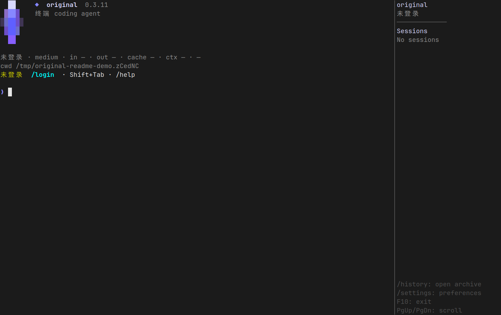
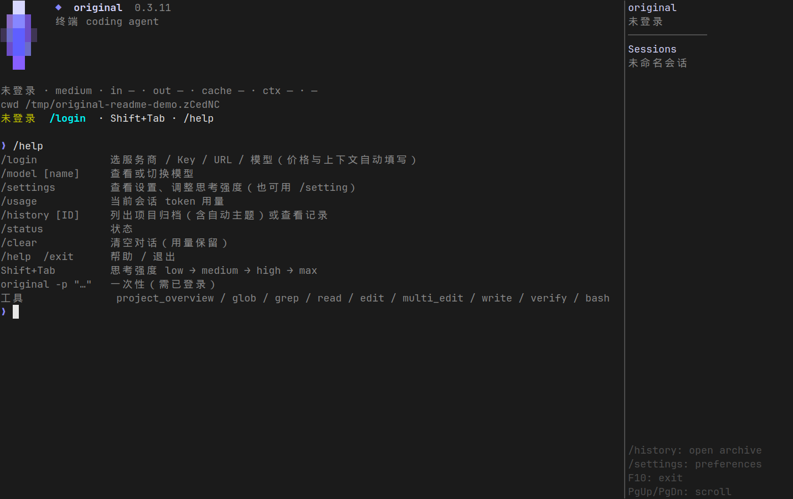

# original-agent

[](https://github.com/haoranyoung09-sys/original-agent/blob/main/.github/workflows/ci.yml)
[](https://github.com/haoranyoung09-sys/original-agent/actions/workflows/ci.yml)
[](https://github.com/haoranyoung09-sys/original-agent/releases/latest)
[](LICENSE)

[简体中文](README.md) · [English](README.en.md) · [日本語](README.ja.md) · **한국어**

Original은 Rust로 만든 터미널 코딩 에이전트입니다. 자연어로 코드를 찾고 파일을 수정한 뒤 프로젝트 테스트를 실행할 수 있습니다. 파일 도구가 바꾼 내용은 프로세스 안에서 되돌릴 수 있고, 세션은 로컬에 저장합니다. 상호작용은 [Pi](https://github.com/badlogic/pi-mono)를 참고했습니다. Pi, Anthropic, OpenAI, Google의 공식 제품이 아닙니다.

이 소스의 패키지 버전은 `0.3.12`입니다. `original --version`, `Cargo.toml`, 태그 `v0.3.12`가 같은 번호입니다. 이미 게시된 태그 `v0.3.11`은 당시의 README와 데모 병합을 그대로 가리키며 패키지 버전은 `0.3.11`입니다. 그 태그는 옮기지 않습니다. 이전 태그 `v0.3.10`의 패키지 버전은 여전히 `0.3.9`입니다. 릴리스 워크플로는 태그와 패키지 버전이 같아야 하므로 `v0.3.10`에는 미리 빌드한 첨부 파일이 없습니다.

배지 네 개는 이 저장소의 실제 데이터입니다. 다운로드 수나 커버리지는 넣지 않습니다.

- **Rust 1.100.0 stable**는 Rust 로고와 툴체인 문자입니다. `Cargo.toml`에 `rust-version`이 없고 MSRV도 선언하지 않았습니다. `1.100.0`은 2026-11-12에 `rustup`이 해석한 stable입니다. CI와 Release 워크플로는 유동 채널 `dtolnay/rust-toolchain@stable`을 설치하며, 이것은 최소 지원 버전이 아닙니다.
- **CI**는 `main`의 [`.github/workflows/ci.yml`](.github/workflows/ci.yml) 최근 결과입니다.
- **release**는 GitHub의 최신 Release입니다. 이 문서를 쓸 때는 `v0.3.11`이었고, 네 개 플랫폼의 첨부가 이미 있습니다. 패키지 `0.3.12` 첨부는 태그 `v0.3.12`의 Release 워크플로가 업로드에 성공한 뒤에야 이 배지에 나타납니다.
- **license**는 저장소 라이선스이며 현재 [MIT](LICENSE)입니다.

## 먼저 볼 곳

1. [설치](#설치와-업데이트). Rust가 없으면 설치 스크립트를 쓰고, 이 버전 소스는 `cargo install --locked --tag v0.3.12`로 설치합니다.
2. `original`을 실행한 뒤 `/login`을 입력합니다. 로그인 전에는 모델을 호출할 수 없습니다.
3. 대화형 터미널은 전체 화면으로 시작합니다. `original --classic`은 줄 단위 화면입니다.

## 화면

아래 두 그림과 짧은 녹화는 release 빌드 `original` 0.3.11을 실제로 실행한 데스크톱 스크린샷입니다. 왼쪽 위 보석은 프로그램이 직접 보내는 256색이며, 채워진 칸의 픽셀은 `#d7d7ff`, `#8787ff`, `#875fff`, `#5f5fff`입니다. 촬영할 때 비어 있지 않은 `NO_COLOR`를 뺐습니다. 이 변수가 있으면 색이 나가지 않아 터미널 기본 글자색으로 회백색이 됩니다. 개념도가 아니고, 터미널 출력을 다시 그린 그림도 아닙니다. 비어 있는 임시 홈과 임시 작업 디렉터리를 사용했고, 로그인과 API 키, 모델 호출은 없습니다. 그림의 `/tmp/original-readme-demo.*`는 그때 만든 빈 디렉터리입니다. 시작 직후 사이드바는 프로그램이 출력한 `No sessions`입니다. `/help` 뒤에는 아직 주제가 없는 로컬 기록 `未命名会话`이 보입니다.





같은 키 입력의 7초 화면 녹화: [fullscreen-help.mp4](docs/assets/fullscreen-help.mp4). 재현 방법은 [docs/assets/capture-readme-demo.sh](docs/assets/capture-readme-demo.sh)입니다. `cargo build --locked --release` 이후 디스플레이, xfce4-terminal, xdotool, ffmpeg가 있는 환경에서 실행합니다.

## 전체 화면 터미널

대화형 시작이 전체 화면 호스트로 들어가는 조건은 모두 만족해야 합니다. `--classic`과 `--subscription`이 없고, `-p`나 위치 인자 프롬프트가 없으며, 표준 입력과 표준 출력이 모두 터미널이어야 합니다. 너비가 110열 이상이면 오른쪽에 고정된 회색 28열 세션 색인을 표시하고, 더 좁으면 숨깁니다. 첫 줄은 모델 이름이고 다음 줄은 사고 강도입니다. 긴 모델 이름이 사고 강도를 가리지 않도록 줄을 나눴습니다. 색인은 클릭할 수 없습니다. 기록을 열려면 `/history ID`를 사용합니다. Page Up / Page Down은 스크롤백을 약 10줄 움직이고, 다른 키는 현재 화면으로 돌아갑니다. F10으로 호스트를 종료합니다. 실행 중 창 제목은 `original`입니다.

호스트는 같은 프로그램을 내장 터미널에서 실행합니다. 로그인, 설정, 명령별 승인은 기존의 줄 단위 프롬프트입니다. 입력은 색이 있는 `❯`뿐이며 대화와 함께 위로 스크롤됩니다. 프롬프트 옆에는 모델 이름이나 사고 강도를 표시하지 않습니다. 시작 부제, 상태 줄(`모델 · 사고 강도`), 사이드바에 표시합니다. `original --classic`, 일회성 실행, 공식 CLI 전달, 터미널이 아닌 표준 입출력은 전체 화면 없이 줄 단위 인터페이스를 사용합니다.

## 설치와 업데이트

Rust가 필요 없는 설치 프로그램은 GitHub Release 첨부를 받아 SHA-256을 확인합니다. 이 체크섬은 별도의 코드 서명이 아닙니다. 이 문서를 쓸 때 Windows x64, Linux x64, macOS Intel, macOS Apple Silicon 첨부가 있는 최신 Release는 `v0.3.11`이었습니다. `v0.3.12` 첨부는 해당 태그가 시작한 Release 워크플로가 업로드에 성공한 뒤에만 있습니다. 첨부가 없으면 설치가 실패하고 기존 바이너리를 덮어쓰지 않습니다.

Windows (PowerShell, x64). `iex (irm …)`를 한 식으로 실행합니다.

```powershell
iex (irm https://raw.githubusercontent.com/haoranyoung09-sys/original-agent/main/scripts/install.ps1)
```

버전 고정:

```powershell
& ([scriptblock]::Create((irm https://raw.githubusercontent.com/haoranyoung09-sys/original-agent/main/scripts/install.ps1))) -Version v0.3.12
```

Linux x64 / macOS Intel 또는 Apple Silicon:

```sh
curl -fsSL https://raw.githubusercontent.com/haoranyoung09-sys/original-agent/main/scripts/install.sh | sh
# 스크립트를 받은 뒤 버전 고정
sh install.sh v0.3.12
```

Windows는 x64만 지원하며 `%USERPROFILE%\.original-agent\bin\original.exe`에 설치하고 사용자 PATH를 갱신합니다. 현재 PowerShell에도 추가되지만, 이미 연 다른 터미널은 다시 열어야 합니다. Unix는 `~/.local/bin/original`에 설치하고, PATH에 없으면 `export` 안내를 출력합니다. Linux 바이너리는 Ubuntu 22.04에서 빌드되며 호환되는 glibc와 native-tls를 통한 시스템 OpenSSL이 필요합니다. macOS와 Windows 첨부는 그 OpenSSL을 사용하지 않습니다.

업데이트는 같은 설치 명령을 다시 실행합니다. Windows에서 `original.exe`가 실행 중이면 덮어쓰기가 실패하고 중단되며 기존 파일이 남습니다. Release를 쓰지 않을 때는 `cargo build --locked --release` 이후 Windows에서 `scripts/install-from-local-build.ps1`을 실행하거나, `scripts/package-local-release.ps1`로 만든 디렉터리를 `install.ps1 -BaseUrl`에 넘깁니다. `ORIGINAL_INSTALL_BASE`도 로컬 첨부 디렉터리를 가리킬 수 있습니다.

소스 설치에는 안정 Rust와 플랫폼 빌드 도구가 필요합니다. crates.io에는 게시되어 있지 않습니다.

```sh
cargo install --locked --git https://github.com/haoranyoung09-sys/original-agent --tag v0.3.12 original-agent
original --version
```

이미 받은 저장소에서는 `cargo install --locked --path . --force`를 사용합니다. Windows는 `scripts/install-original.ps1`, Unix는 `sh scripts/install-original.sh`도 가능합니다. Cargo bin 디렉터리가 PATH에 있어야 합니다. 의존성이 캐시되어 있으면 `--offline`을 쓸 수 있습니다.

## 로그인, 모델, 사고 강도

`/login`은 위아래 방향키로 선택하고 Enter로 확인하며 Esc로 취소합니다. 대화형 터미널이 필요합니다. 첫 메뉴의 중국어 라벨은 `API`, `本地模型 (GGUF / llama-server，无需运行 Ollama)`, `订阅`입니다. API 메뉴에는 Anthropic, OpenAI, DeepSeek Anthropic 호환, DeepSeek OpenAI 호환, 사용자 지정 Anthropic 호환, 사용자 지정 OpenAI 호환이 있습니다. API 키 입력은 `*`로 가립니다. 비워 두면 저장된 키를 유지합니다. base URL이 바뀌면 저장된 키를 먼저 지웁니다. 설정 파일은 `~/.original-agent/config.json`이고 키는 평문입니다. Unix에서는 `0o600`으로 기록합니다.

| 연결 | 구현된 경로 |
| --- | --- |
| Anthropic | Messages API. 기본 모델 `claude-sonnet-4-20250514` |
| OpenAI | Chat Completions. 기본 모델 `gpt-4.1`. 다른 프로토콜이 필요한 모델로 자동 전환하지 않습니다 |
| DeepSeek | 메뉴에 Anthropic 호환 `https://api.deepseek.com/anthropic`와 OpenAI 호환 `https://api.deepseek.com`가 모두 있습니다. 기본 모델은 둘 다 `deepseek-flash` |
| xAI / Grok | 사용자 지정 OpenAI 호환 주소에 `https://api.x.ai/v1`를 넣고 `/model`로 모델을 지정합니다. 내장 구독 OAuth는 없고 가격표에도 xAI가 없습니다. `--subscription grok`는 지원하지 않는다고 반환합니다 |
| Gemini | 공식 Gemini CLI로 터미널을 넘깁니다. 네이티브 Gemini API는 없습니다 |
| 사용자 지정 | API 방식은 메뉴의 두 항목으로 고릅니다. 그다음 묻는 것은 URL뿐입니다. 모델은 `my-model`, 컨텍스트는 128000, 단가는 없습니다 |
| 로컬 GGUF | `/login`에서 `本地模型`을 고릅니다. 이미 있는 Ollama 가중치나 `.gguf`를 읽고, 사용자가 준비한 `llama-server`를 실행합니다. 사용법과 제한은 다음 절 |
| 이미 실행 중인 서버 | 사용자 지정 OpenAI 호환 주소에 URL을 넣습니다. 이 경로는 `llama-server`를 실행하지 않습니다 |

URL은 HTTPS여야 합니다. HTTP는 `localhost`, `127.0.0.1`, `[::1]`만 허용합니다. 계정 정보, 쿼리, 프래그먼트는 거부합니다. 가격과 컨텍스트는 `src/model_catalog.rs`의 공개 자료 스냅샷(확인일 2026-11-06)이며 실행 중에 공식 사이트를 가져오지 않습니다. `/login`은 프리셋의 모델, 컨텍스트, 입력/출력 단가를 저장합니다. 캐시 읽기 단가는 대조표에 있을 때만 저장합니다. `/model <name>`은 알려진 ID면 그 값을 덮어쓰고, 모르는 ID면 현재 값을 유지한 채 안내를 출력합니다. 공식 CLI 사용료는 이 단가로 계산하지 않습니다. 로컬 GGUF 로그인은 컨텍스트를 32768로 쓰고 단가를 비우며 이 대조표를 보지 않습니다.

## 로컬 GGUF

프로세스 안에서의 추론은 없습니다. 모델을 받지 않고 Ollama나 Gemma를 임베드하지도 않습니다. 로컬 GGUF는 사용자가 준비한 외부 `llama-server`를 실행할 뿐입니다. Ollama 데몬에는 접속하지 않습니다.

검색 결과는 모델 ID로 정렬하고, 메뉴의 마지막 항목은 항상 경로를 직접 입력하는 줄입니다.

- Ollama 디렉터리는 `OLLAMA_MODELS`가 비어 있지 않으면 그 값이고, 아니면 `~/.ollama/models`입니다. `manifests/`와 `blobs/`를 읽습니다. 미디어 타입이 `application/vnd.ollama.image.model`이고 해당 blob 파일이 있는 레이어만 사용합니다. `registry.ollama.ai/library`는 `모델:태그`로, 같은 레지스트리의 다른 네임스페이스는 `네임스페이스/모델:태그`로 표시합니다.
- `~/.original-agent/models` 아래 깊이 6단계까지의 `.gguf`입니다. 모델 ID는 확장자를 뺀 파일 이름입니다.
- 직접 입력한 경로는 이미 있는 파일이어야 합니다. 확장자는 검사하지 않습니다. 모델 ID는 파일 이름 줄기이고, 없으면 `local-model`입니다.

`llama-server`는 저장소에 없고 llama.cpp도 받지 않습니다. 찾는 순서는 `ORIGINAL_LLAMA_SERVER`(파일이어야 함), `~/.original-agent/bin/llama-server`(Windows에서는 `llama-server.exe`), 그다음 `PATH`입니다. 없으면 로그인이 실패하고 저장된 설정은 바뀌지 않습니다. 로그인은 먼저 현재 백엔드를 내려놓습니다. 시작에 실패하면 이 프로세스의 연결은 끊기고, 다음 메시지는 다시 `/login`을 요구합니다.

수신 주소는 `127.0.0.1`의 빈 포트입니다.

```text
llama-server -m <gguf> --host 127.0.0.1 --port <포트> --jinja -c <컨텍스트> --alias <모델 ID>
```

로컬 로그인이 저장하는 컨텍스트는 32768이고, `-c`에 넘기는 값은 최소 2048입니다. 표준 출력과 표준 오류는 `~/.original-agent/llama-server.log`에 씁니다. `GET /health`가 성공할 때까지 최대 90초를 기다립니다. 일찍 종료하거나 시간이 넘으면 실패하고, 로그 끝의 최대 12줄을 함께 출력합니다. 이 자식 프로세스는 종료할 때와 다른 로그인으로 바꿀 때를 포함해, 해당 백엔드가 끝나면 kill됩니다.

접속은 같은 OpenAI Chat Completions 클라이언트를 쓰고 주소는 `http://127.0.0.1:<포트>/v1`이며, 헤더는 항상 `Authorization: Bearer local`입니다. 다른 로컬 키로 바꾸는 설정은 없습니다. 단가가 비어 비용 추정도 비어 있습니다. 성공하면 터미널에 `已连接本地模型（未运行 Ollama）。`를 출력하고, 그때의 URL, 모델 ID, `local_model_path`를 `~/.original-agent/config.json`에 기록합니다.

다음 실행에서 provider가 `local`이고 모델 이름과 `local_model_path`가 비어 있지 않으면 새 포트로 `llama-server`를 다시 실행합니다. 대화 모드에서 시작에 실패하면 오류를 출력하고 로그인되지 않은 상태로 두어 `/login`을 다시 할 수 있습니다. 일회성 모드는 그 오류로 종료합니다. 새 요청은 새 포트를 사용합니다. 자동 시작이 저장된 `base_url`을 매번 다시 쓰지는 않습니다.

이것은 코드의 제한이며, 특정 GGUF의 답변 품질을 검증했다는 뜻이 아닙니다.

- 프로세스 내 추론도, 함께 제공되는 모델이나 `llama-server`도 없습니다. GPU, Vulkan, CPU는 넣어 둔 바이너리의 동작이고 이 프로그램은 백엔드를 고르지 않습니다.
- 이미 받아 둔 Ollama 가중치만 읽습니다. 모델이 없으면 이 검색은 비어 있습니다.
- 도구 호출은 OpenAI 호환 `tools` 루프이며 최대 24라운드입니다. GGUF가 도구 호출을 내는지는 그 모델과 `llama-server`의 대화 템플릿에 달립니다. 이 저장소는 실제 가중치로 추론을 검증하지 않았습니다.
- 저장하는 컨텍스트는 32768로 고정이며 GGUF 메타데이터의 실제 창을 읽지 않습니다.
- 사고 강도는 저장할 수 있지만 이 경로는 `reasoning_effort`를 보내지 않습니다. `--show-thinking`은 응답에 `reasoning_content`가 있을 때만 표시합니다. 사고만 있고 본문도 도구 호출도 없는 라운드는 대화 기록에 남지 않습니다.

환경 변수는 `ORIGINAL_API_KEY`, `ANTHROPIC_API_KEY`, `OPENAI_API_KEY`, `DEEPSEEK_API_KEY`, `CLAUDIUS_API_KEY` 순서로 첫 번째 비어 있지 않은 값을 사용합니다. 선택한 제공자로 거르지 않습니다. 사용자 설정 디렉터리의 `.env`는 읽고 프로젝트 디렉터리의 `.env`는 읽지 않습니다.

구독은 PATH에 있는 공식 CLI에 대해 `original --subscription codex`, `original --subscription claude`, `original --subscription gemini`를 실행하거나 `/login`에서 고릅니다. 인증, 권한, 세션, 청구는 공식 클라이언트가 담당합니다. original 안에서 구독 모델을 직접 호출하는 기능이 아니며, 브라우저 쿠키나 공식 인증 캐시를 복사하지 않습니다. `--allow-shell`은 전달 이후에는 적용되지 않습니다. 명령줄 `--subscription`은 사용자 설정 `.env`를 읽기 전에 넘기므로 시작 시점의 환경만 상속합니다. REPL에 들어온 뒤 `/login`에서 고르면 이미 읽은 사용자 설정 변수를 공식 CLI가 상속합니다. 두 경로 모두 프로젝트 `.env`는 읽지 않습니다.

## 작업 디렉터리와 명령

```sh
original --cwd /path/to/project
original -p "프로젝트 구조를 설명해 줘"
original 프로젝트 구조를 설명해 줘
original --classic
original --allow-shell
original --auto-verify
original --show-tools
original --show-thinking
```

`-p`와 위치 인자는 모두 일회성 프롬프트이며 둘 다 있으면 `-p`를 사용합니다. 저장된 로그인이 필요합니다. 설정 또는 환경 변수의 API 키이거나, 저장된 로컬 GGUF 경로입니다. 전체 화면으로 들어가지 않습니다.

`--cwd`는 시작 시 현재 디렉터리 기준으로 해석하며 존재해야 하고 정규화합니다. Git 루트 탐색은 하지 않습니다. 생략하면 현재 디렉터리에서 위로 올라가 가장 가까운 `.git`을 작업 루트로 삼습니다. 없으면 현재 디렉터리입니다. 저장소 하위 디렉터리에서 시작하면 파일 도구의 루트는 Git 루트입니다. 홈 디렉터리 전용 프로젝트 선택 메뉴는 없습니다. 전체 화면, 클래식, `--subscription`이 같은 디렉터리 규칙을 사용합니다. 파일 도구는 작업 루트 밖으로 나갈 수 없습니다. 대화 턴이 끝나면 그 턴의 파일 도구가 기록한 경로와 Git이 보는 스테이지되지 않은 변경, 추적되지 않은 변경을 출력합니다. Git을 쓸 수 없으면 파일 도구 기록만 출력합니다.

| 명령 | 기능 |
| --- | --- |
| `/login` | API, 로컬 GGUF, 구독 중 하나를 고릅니다. API는 제공자와 키, 로컬은 기존 가중치나 직접 입력한 경로 |
| `/model`, `/model <name>` | 모델 표시 또는 전환. 알려진 ID는 대조표를 적용 |
| `/settings`, `/setting`, `/config` | 모델, 사고 강도, 제한 시간, 자동 검증을 보고 사고 강도를 변경 |
| `/status` | 모델, 사용량, 비용 추정 |
| `/usage` | 현재 세션의 토큰 수 |
| Shift+Tab | low, medium, high, max를 순환해 저장 |
| `/history`, `/history ID` | 현재 작업 디렉터리의 기록 목록 또는 한 건 보기 |
| `/sessions`, `/session show <id>` | 짧은 목록 또는 지정 기록 보기 |
| `/export` | 현재 기록을 같은 디렉터리의 `summary.md`로 저장 |
| `/diff` | 파일 도구의 전체 치환 diff 표시 |
| `/undo`, `/undo all` | 최근 배치 또는 기록된 전체를 되돌림 |
| `/clear` | 대화를 지우고 누적 사용량은 유지 |
| `/help`, `/?`, `/exit`, `/quit` | 도움말과 종료 |

Shift+Tab과 `/settings`가 저장하는 값은 low, medium, high, max라는 이름입니다. `❯`는 고정 색이며 사고 강도에 따라 흰색, 녹색, 보라색, 빨간색으로 바뀌지 않습니다. Anthropic 요청에는 adaptive thinking 설정이 들어가고 수준은 `output_config.effort`로 전달됩니다. OpenAI 호환 요청은 `reasoning_effort`를 보내지 않으므로 로컬 수준이 그 요청 본문을 바꾸지 않습니다. `NO_COLOR`가 비어 있지 않으면 주 화면의 ANSI 색을 끕니다. 빈 값은 설정하지 않은 것과 같습니다. 도구 상태 줄은 변수가 존재하기만 해도 색을 끄며, `--show-tools`와 터미널 출력도 필요합니다.

## 도구, 실행 승인, 검증, 오류

작업 디렉터리 안의 파일 읽기와 쓰기는 기본적으로 허용됩니다. 도구 로그는 기본적으로 숨기며 `--show-tools`일 때 도구 이름, 경로 또는 명령, 소요 시간, 성공과 실패를 표시합니다.

`--allow-shell`이 없으면 모델의 `bash`와 `verify`, 그리고 자동 검증은 실행 전에 디렉터리와 명령을 터미널에서 확인합니다. `y` 또는 `yes`만 그 한 번을 허용하고, 빈 입력이나 다른 대답은 거부합니다. 거부하거나 질문할 수 없으면 종료 코드 126과 `--allow-shell`을 쓰라는 문장을 반환합니다. 대화 상자는 없습니다. 표준 입력이나 표준 오류가 터미널이 아니면 질문할 수 없으므로 비대화 실행에는 `--allow-shell`이 필요합니다. `--allow-shell`은 확인을 건너뛰고 사용자 권한으로 임의의 명령을 실행할 수 있습니다. 신뢰하는 환경에서만 사용하고 [SECURITY.md](SECURITY.md)를 읽으세요. Windows 셸은 PowerShell이고 Unix는 `sh -c`입니다.

공통 도구는 `project_overview`, `glob`, `grep`, `read`, `edit`, `write`, `multi_edit`, `verify`, `bash`입니다. 승인이 없는 `verify`는 제안 명령만 반환합니다. `original --auto-verify`는 `--allow-shell`과 별개의 스위치이며 감지한 프로젝트 명령 하나만 실행합니다. `Cargo.toml`이면 `cargo test --locked`, `package.json`이면 `npm test --silent`, `pyproject.toml` 또는 `pytest.ini`이면 `python -m pytest -q`, `go.mod`이면 `go test ./...`입니다. 이 명령은 저장소 코드를 실행합니다. 대화 모드에서는 이번 턴에 파일 도구의 새 기록이 있거나 Git이 새 미스테이징 또는 미추적 변경을 보고할 때만 검증합니다. 실패하면 줄인 stdout/stderr를 모델에 돌려주고 수리는 최대 세 번입니다. 새 작업 트리 변경이 없는 수리 턴에서 멈춥니다. 지원 명령이 없으면 설명만 출력하고 계속합니다. 일회성 모드는 한 번만 검증하고 모델에 수리를 요청하지 않습니다. 명령이 없거나 테스트가 0이 아니면 프로세스가 실패합니다.

`--command-timeout` 기본값은 600초이고 범위는 1–600입니다. 셸과 자동 검증의 상한이며 HTTP 제한 시간은 바꾸지 않습니다. OpenAI 호환 클라이언트의 HTTP 제한 시간은 300초입니다. `429`, `500`, `502`, `503`, `504`와 연결, 시간 초과, 요청 오류는 최대 세 번 더 재시도합니다. 대기는 지수 백오프이거나 최대 30초인 `Retry-After`입니다. 그 밖의 HTTP 실패는 상태와 본문을 출력합니다. 깨진 도구 인자 JSON은 도구 결과 안의 오류 문자열로 모델에 돌려줍니다. 로그인 실패, API 키 없음, 모델 호출 실패는 터미널 문장입니다. API, 키, 모델 오류 팝업은 없습니다.

OpenAI 호환 경로(로컬 `llama-server` 포함)에서 어떤 라운드에 본문도 도구 호출도 없으면, 그 빈 assistant 메시지는 대화 기록에 쓰지 않습니다. 이후 요청에서도 `content`와 `tool_calls`가 모두 없는 assistant 메시지는 빼 버립니다. `finish_reason`이 `length`이면 출력이 `--max-tokens`에 도달했고 본문이 없다고 터미널에 출력합니다. 그 외에는 본문도 도구 호출도 없어 빈 메시지를 건너뛰었다고 출력합니다. 이 라운드는 자동으로 다시 시도하지 않으며, 해당 사용자 메시지는 기록에 남습니다. 이 처리는 Anthropic Messages 경로에는 적용되지 않습니다. 화면에 나오는 사고 강도를 낮추라는 안내는 OpenAI 호환 요청 본문을 바꾸지 않습니다. `--show-thinking`은 서버가 돌려준 `reasoning_content`만 표시하고 출력 예산을 늘리지 않습니다. `--max-tokens`를 올리면 요청의 `max_tokens`는 바뀝니다.

`--show-thinking`은 제공자가 실제로 사고 텍스트를 돌려줄 때만 표시합니다. Anthropic은 응답 뒤의 thinking 블록이고, OpenAI 호환은 스트리밍 `reasoning_content`입니다. 프로그램이 사고 문장을 만들어 내지는 않습니다. 기본값은 꺼짐입니다.

`/diff`는 이 프로세스에 남은 전체 치환 diff이며 최소 unified diff가 아닙니다. `/undo`와 `/undo all`은 파일 도구 스냅샷만 되돌리고, 밖에서 바뀐 파일은 거부합니다. 스냅샷은 메모리에만 있으며 종료하면 사라집니다. 셸이나 공식 CLI가 바꾼 파일은 덮지 않습니다. 일괄 쓰기 실패 시 복원을 시도하고, 복원 실패도 보고합니다. 전원 중단에 대한 원자성은 없습니다. 되돌리는 중 I/O 오류가 나면 일부만 복원될 수 있습니다.

## 기록의 자동 주제

기본 저장 위치는 `~/.original-agent/sessions/<타임스탬프-ID>/`의 `metadata.json`과 `events.jsonl`입니다. 첫 번째 충분히 긴 사용자 말에서 첫 문장을 골라 사이드바 너비로 줄인 뒤 `topic`에 저장합니다. 이후 말은 주제를 바꾸지 않습니다. `/history`와 전체 화면 사이드바가 이 주제를 표시합니다. 주제가 없는 이전 기록은 첫 사용자 말로 보완하고, 그래도 없으면 `未命名会话`으로 표시합니다. `/sessions`는 metadata의 cwd가 현재 작업 디렉터리와 같은 기록만 나열합니다. `/export`는 `summary.md`를 씁니다. `original --no-record`는 이번 실행의 아카이브를 끕니다. 공식 CLI 전달은 기록하지 않습니다.

완료된 턴, 오류 문장, 자동 검증의 명령, 종료 코드, 출력, 소요 시간을 기록합니다. 진행 중인 턴은 비정상 종료 때 잃을 수 있습니다. 로그인 양식은 기록하지 않습니다. 저장된 키와 인증 줄은 가리지만, 임의의 문장 속 다른 비밀을 항상 식별하지는 못합니다. 기록을 열어도 모델 대화가 재개되거나 파일이 복원되지는 않습니다. 보관 기간이나 삭제 명령은 없습니다. 줄 편집 기록은 별도 파일 `~/.original-agent/history`이며 아카이브를 꺼도 지워지지 않습니다.

## Office, OCR, 구성

DOCX와 PPTX를 읽고 쓰려면 Python 3와 `python-docx`, `python-pptx`가 필요합니다. PNG, JPEG, BMP, TIFF 읽기는 PATH의 Tesseract를 `chi_sim+eng`로 호출합니다. 이 프로그램이 없으면 해당 파일 작업이 문장 오류로 실패합니다.

Rust 본체는 Anthropic 호환 API에 커뮤니티 SDK claudius 0.33.0을 쓰고, OpenAI 호환 API에는 reqwest를 사용합니다. OpenAI 호환은 `stream: true`이며 `Content-Type`이 JSON이면 한 덩어리 JSON으로 읽습니다. Responses API는 없습니다. 로컬 GGUF도 이 클라이언트를 쓰며, 그 전에 외부 `llama-server`를 실행합니다. 요청이 컨텍스트 창에 가까워지면 전송하는 메시지의 오래된 중간 턴을 줄이지만, 로컬 기록과 아카이브는 원래 메시지를 유지합니다.

화면이 깨지면 F10으로 나간 뒤 `original --classic`을 사용해 보세요.

[Office / OCR](docs/archive/office-tools.md) · [Security](SECURITY.md) · [MIT License](LICENSE) · [Contributing](CONTRIBUTING.md)
