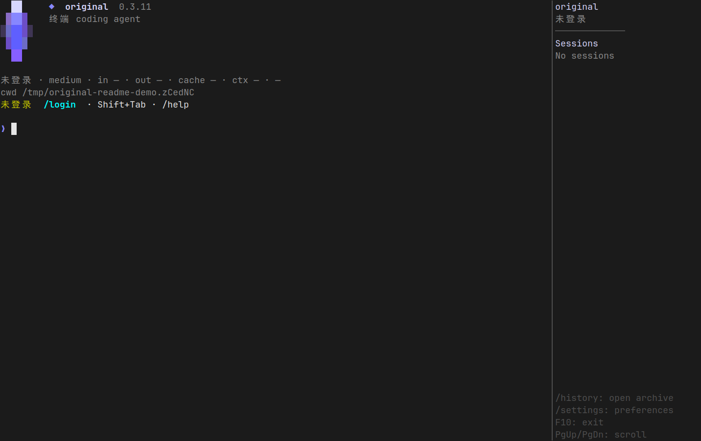
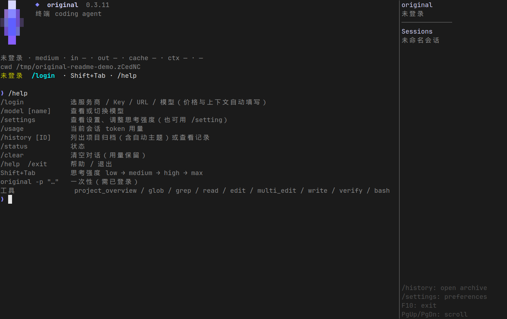
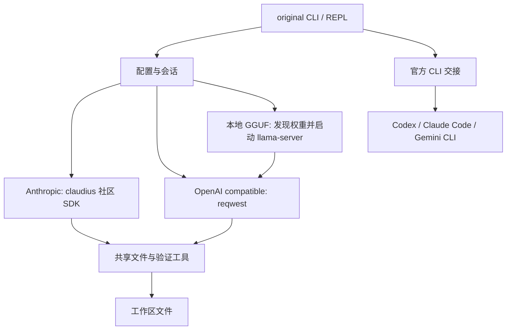

# original-agent

[](https://github.com/haoranyoung09-sys/original-agent/blob/main/.github/workflows/ci.yml)
[](https://github.com/haoranyoung09-sys/original-agent/actions/workflows/ci.yml)
[](https://github.com/haoranyoung09-sys/original-agent/releases/latest)
[](LICENSE)

**简体中文** · [English](README.en.md) · [日本語](README.ja.md) · [한국어](README.ko.md)

在终端里用自然语言查代码、改文件、运行项目测试。Original 以 Rust 构建，支持 Anthropic 和 OpenAI 兼容 API，内置改动回退和本地会话归档。交互设计参考 [Pi](https://github.com/badlogic/pi-mono)。

当前源码的包版本是 `0.3.12`。`original --version`、`Cargo.toml` 与标签 `v0.3.12` 使用同一个版本号。已发布的标签 `v0.3.11` 仍指向当时的 README 与演示合并，包版本是 `0.3.11`，不要移动它。更早的标签 `v0.3.10` 仍指向包版本 `0.3.9`，发布流程要求两者一致，所以该标签没有预编译附件。

四枚徽章都指向本仓库的真实数据，没有下载量或覆盖率：

- **Rust 1.100.0 stable** 使用 Rust 标志，文字是工具链版本。`Cargo.toml` 没有 `rust-version`，仓库也没有声明 MSRV。`1.100.0` 是 2026-11-12 由 `rustup` 解析到的 stable；CI 与 Release 工作流安装的是浮动通道 `dtolnay/rust-toolchain@stable`，不是最低支持版本。
- **CI** 读取 `main` 分支上 [`.github/workflows/ci.yml`](.github/workflows/ci.yml) 最近一次的实际结果。
- **release** 读取 GitHub 最新已发布的 Release。编写本文时是 `v0.3.11`，该 Release 已有四个平台的附件。源码包版本 `0.3.12` 的附件要等标签 `v0.3.12` 的 Release 工作流上传成功后，才会变成这个徽章显示的版本。
- **license** 读取仓库许可证，当前是 [MIT](LICENSE)。

## 先看这里

1. [安装](#安装)。没有 Rust 时运行安装脚本；安装这一版源码用 `cargo install --locked --tag v0.3.12`。
2. 运行 `original`，再输入 `/login`。没有登录时不能调用模型。
3. 交互终端默认进入全屏。`original --classic` 使用行式界面。

## 界面

下面两张图和短片是同一次真实运行的桌面截图，不是概念图，也不是把终端输出重新绘制成的图片。左上角宝石是程序发出的 256 色；实心块像素为 `#d7d7ff`、`#8787ff`、`#875fff`、`#5f5fff`。捕获时去掉了非空的 `NO_COLOR`，否则这些颜色不会发出，终端会用默认文字色把宝石画成灰白。程序是 release 构建的 `original` 0.3.11。临时主目录和临时工作目录都是空的，没有登录、没有 API Key，也没有调用模型。画面中的 `/tmp/original-readme-demo.*` 是这次截图创建的空目录。启动瞬间侧栏原文是 `No sessions`；输入 `/help` 之后，侧栏显示还没有主题的本地归档 `未命名会话`。





同一轮按键的 7 秒屏幕录像：[fullscreen-help.mp4](docs/assets/fullscreen-help.mp4)。重现命令是 [docs/assets/capture-readme-demo.sh](docs/assets/capture-readme-demo.sh)。需要已经执行 `cargo build --locked --release`，以及显示器、xfce4-terminal、xdotool 和 ffmpeg。

## 全屏终端

交互启动在同时满足这些条件时进入全屏宿主：没有 `--classic`、没有 `--subscription`、没有 `-p` 或位置参数提示，并且标准输入和标准输出都是终端。宽度达到 110 列时，右侧用固定灰色显示 28 列会话索引；更窄时隐藏。侧栏第一行是模型名，下一行单独是思考强度，避免被长模型名截掉。它只是索引，不能点选；用 `/history ID` 打开归档。Page Up / Page Down 每次滚动约 10 行，其他按键回到当前画面。F10 退出宿主。运行中的窗口标题是 `original`。

全屏宿主把同一个程序放进内嵌终端，登录、设置和逐次命令确认仍是原来的行式提示。输入提示符只有彩色的 `❯`，随对话向上滚动，旁边不显示模型名或思考强度。启动图标旁的副标题和状态行会显示 `模型 · 思考强度`。`original --classic`、一次性模式、官方 CLI 交接，以及非终端的标准输入/输出，直接使用行式界面，不进入全屏宿主。

## 安装

无需 Rust 的安装方式下载 GitHub Release 附件并校验 SHA-256。校验不是独立代码签名。截至本文编写时，已带 Windows x64、Linux x64、macOS Intel 和 Apple Silicon 附件的最新 Release 是 `v0.3.11`。`v0.3.12` 的附件要等标签触发的 Release 工作流上传成功后才存在；附件缺失时安装失败，不会覆盖已有程序。

Windows PowerShell（x64）。把 `iex (irm …)` 作为一整段执行，不要把脚本粘进交互提示符：

```powershell
iex (irm https://raw.githubusercontent.com/haoranyoung09-sys/original-agent/main/scripts/install.ps1)
```

固定版本：

```powershell
& ([scriptblock]::Create((irm https://raw.githubusercontent.com/haoranyoung09-sys/original-agent/main/scripts/install.ps1))) -Version v0.3.12
```

不经过 `iex`：

```powershell
Invoke-WebRequest -UseBasicParsing -Uri https://raw.githubusercontent.com/haoranyoung09-sys/original-agent/main/scripts/install.ps1 -OutFile $env:TEMP\original-install.ps1
powershell -NoProfile -ExecutionPolicy Bypass -File $env:TEMP\original-install.ps1
```

Linux x64 / macOS Intel、Apple Silicon：

```sh
curl -fsSL https://raw.githubusercontent.com/haoranyoung09-sys/original-agent/main/scripts/install.sh | sh
# 下载脚本后固定版本
sh install.sh v0.3.12
```

Windows 仅 x64，安装到 `%USERPROFILE%\.original-agent\bin\original.exe` 并写入用户 PATH（当前 PowerShell 会话也会加上；其他已打开的终端需要重新打开）。Unix 安装到 `~/.local/bin`，目录不在 PATH 时会打印 `export` 提示。Linux 构建基于 Ubuntu 22.04，需要兼容的 glibc，并通过 native-tls 使用系统 OpenSSL。macOS 和 Windows 预编译包不使用这套 OpenSSL。

更新时重复同一条安装命令。脚本校验后覆盖同一路径。Windows 上如果 `original.exe` 正在运行，覆盖会失败并中止，已安装文件保持不变。不走 GitHub Release 时，可先 `cargo build --locked --release`，再运行 `scripts/install-from-local-build.ps1`，或用 `scripts/package-local-release.ps1` 生成目录后执行 `install.ps1 -BaseUrl`。`ORIGINAL_INSTALL_BASE` 也可指向本地附件目录。

### 从源码安装

需要稳定版 Rust 和平台编译工具。尚未发布到 crates.io。

```sh
cargo install --locked --git https://github.com/haoranyoung09-sys/original-agent --tag v0.3.12 original-agent
original --version
```

本地仓库：`cargo install --locked --path . --force`。Windows 可运行 `scripts/install-original.ps1`，Unix 可运行 `sh scripts/install-original.sh`。Cargo 的 bin 目录必须在 PATH 中。依赖已缓存时，`cargo install` 可以加 `--offline`。

维护者发布：推送与 `Cargo.toml` 相同的 `v*` 标签。Release 工作流会先检查标签名，再构建上述四个平台并附带 `.sha256`。不要给已有标签移动或重复创建 Release。

## 技术架构与 SDK

本项目是 Rust 2021 编写的独立终端应用，不是 Pi 的官方 Rust 版本，也不隶属于 Anthropic、OpenAI 或 Google。

- **运行时**：Tokio；Clap 解析启动参数；Rustyline 管理行式输入。全屏宿主使用 crossterm、portable-pty 和 vt100。
- **Anthropic 协议**：社区 Rust SDK [claudius](https://github.com/rescrv/claudius) 0.33.0，位于 [vendor/claudius](vendor/claudius)。这不是 Anthropic 官方 Rust SDK。本地修改保留 Windows 编译适配，并把自定义工具序列化为不含服务端 `type` 标签的 schema。
- **OpenAI 兼容协议**：reqwest 与 Serde 实现 Chat Completions 和工具循环。请求使用 `stream: true`；响应 `Content-Type` 为 JSON 时按整段 JSON 读取。没有 Responses API 后端。本地 GGUF 也使用这个客户端，前面多一个由本程序拉起的外部 `llama-server`。
- **共享编码工具**：读、写、唯一替换、批量替换、glob、字面 grep、项目概览和验证，以及当前进程快照、回退和本地会话归档。



| 模块 | 职责 |
| --- | --- |
| `src/main.rs`、`src/ui.rs`、`src/terminal.rs` | 启动、行式界面、全屏宿主 |
| `src/agent.rs`、`src/openai_client.rs` | 两种协议的模型调用 |
| `src/local_model.rs` | 发现已有 GGUF，启动并在后端结束时杀掉 `llama-server` |
| `src/tools.rs`、`src/tool_dispatch.rs`、`src/fsops.rs` | 统一编码工具与文件操作 |
| `src/changes.rs`、`src/archive.rs` | 进程内改动记录与磁盘会话归档 |
| `src/subscription.rs` | 交接给已安装的官方客户端 |

## 模型兼容范围

下表是当前代码里的预设和接入路径，不代表每个模型都经过真实账号测试。程序没有进程内推理，不下载模型，也不嵌入 Ollama 或 Gemma。本地 GGUF 会另外启动用户自己准备的 `llama-server`。

| 服务 | 内置预设 / 接入方式 | 说明 |
| --- | --- | --- |
| Anthropic Claude | `claude-sonnet-4-20250514`，Messages API | `/login` 选择 Anthropic。其他模型 ID 可以配置，但思考和工具参数必须被该服务接受 |
| OpenAI | `gpt-4.1`，Chat Completions | `/login` 选择 OpenAI。不支持此协议的模型不会自动改走别的 API |
| DeepSeek | 菜单同时提供 Anthropic 兼容 `https://api.deepseek.com/anthropic` 和 OpenAI 兼容 `https://api.deepseek.com`，默认模型都是 `deepseek-flash` | `/model deepseek-v4-pro` 等对照表中的 ID 会覆盖上下文和单价 |
| Grok / xAI | 自定义 OpenAI 兼容地址 `https://api.x.ai/v1` | 没有内置订阅 OAuth，对照表也不含 xAI 模型。`--subscription grok` 直接返回不支持 |
| Gemini | 官方 Gemini CLI 交接 | 没有原生 Gemini API 后端 |
| 自定义服务商 | 菜单分「自定义 Anthropic 兼容」和「自定义 OpenAI 兼容」 | 只再询问 URL。模型固定为 `my-model`，上下文 128000，没有单价。地址必须是 HTTPS；只有 `localhost`、`127.0.0.1` 和 `[::1]` 允许 HTTP。不能带账号、查询参数或片段 |
| 本地 GGUF | `/login` 选「本地模型」 | 读取已有的 Ollama 权重或 `.gguf`，再启动用户自备的 `llama-server`。用法和限制见下一节 |
| 已经在运行的 OpenAI 兼容服务 | 自定义 OpenAI 地址 | 把 URL 填进自定义 OpenAI 预设。这条路径不启动 `llama-server` |

模型价格和上下文来自 `src/model_catalog.rs` 的公开资料快照，核对日期 2026-11-06，不会实时抓取官网。`/login` 写入预设的默认模型、上下文和输入/输出单价；缓存读取单价只在对照表命中时写入。`/model <name>` 再按模型名覆盖，未知模型保留当前值并提示。官方 CLI 模式不按本项目的 API 单价计算费用。本地 GGUF 登录会把上下文写成 32768 并清空单价，不查这张对照表。

## 本地 GGUF

`/login` 的第一级菜单是「API」「本地模型 (GGUF / llama-server，无需运行 Ollama)」「订阅」。选本地模型时程序只使用本机已经存在的权重，不下载模型，也不连接 Ollama 守护进程。

扫描结果按模型 ID 排序，菜单最后一项始终是手动输入路径：

- Ollama 目录：`OLLAMA_MODELS` 非空时用它，否则用 `~/.ollama/models`。读取其中的 `manifests/` 和 `blobs/`。只采用媒体类型为 `application/vnd.ollama.image.model`、并且对应 blob 文件存在的层。`registry.ollama.ai/library` 下的清单显示为 `模型:标签`，其他 registry 命名空间显示为 `命名空间/模型:标签`。
- `~/.original-agent/models` 里、递归深度不超过 6 层、扩展名为 `.gguf` 的文件。模型 ID 是去掉扩展名的文件名。
- 手动路径必须是已经存在的文件，不检查扩展名。模型 ID 是文件名主干；取不到时用 `local-model`。

`llama-server` 不在仓库里，程序也不会下载 llama.cpp。查找顺序是：`ORIGINAL_LLAMA_SERVER`（必须是一个文件）、`~/.original-agent/bin/llama-server`（Windows 上是 `llama-server.exe`）、然后是 `PATH`。找不到就登录失败，已保存的配置不变。登录会先放下当前后端；启动失败后，当前进程里的连接已经断开，下一条消息会要求重新 `/login`。

找到之后，程序在 `127.0.0.1` 上选一个空闲端口并启动：

```text
llama-server -m <gguf> --host 127.0.0.1 --port <端口> --jinja -c <上下文> --alias <模型 ID>
```

本地登录写入的上下文是 32768；传给 `-c` 的值至少是 2048。标准输出和标准错误写到 `~/.original-agent/llama-server.log`。程序最多等 90 秒，直到 `GET /health` 返回成功。进程提前退出或超时都会失败，并带上日志末尾最多 12 行。这个子进程在当前后端结束时被杀掉，包括退出程序和改用别的登录方式。

连接使用同一套 OpenAI Chat Completions 客户端，地址是 `http://127.0.0.1:<端口>/v1`，请求头固定为 `Authorization: Bearer local`，没有可以改的本地密钥。单价被清空，所以费用估算为空。成功时终端显示「已连接本地模型（未运行 Ollama）。」，并把当时的地址、模型 ID 和 `local_model_path` 写入 `~/.original-agent/config.json`。

下次启动时，只要 provider 是 `local`、模型名非空、并且保存了非空的 `local_model_path`，就会再启动一次 `llama-server`，并改用新的端口。交互模式启动失败时打印错误，会话保持未登录，可以再输入 `/login`。一次性模式启动失败则进程报错退出。自动启动会用新端口发起请求，但不会在每次启动时改写已经保存的 `base_url`。

这些限制是代码里的行为，不是对某个 GGUF 的推理验收：

- 没有进程内推理，也没有随程序打包的模型或 `llama-server`。GPU、Vulkan 或 CPU 取决于你放进去的那个二进制，本程序不选择后端。
- 只读取已经下载好的 Ollama 权重。Ollama 没有下过模型时，这一路扫描为空。
- 工具调用沿用 OpenAI 兼容的 `tools` 循环，最多 24 轮。某个 GGUF 会不会发出工具调用，取决于该模型和 `llama-server` 的对话模板。本仓库没有用真实权重做推理验收。
- 上下文固定写成 32768，不读取 GGUF 元数据里的真实窗口。
- 思考强度可以保存，但这条路径不发送 `reasoning_effort`。`--show-thinking` 只在响应里有 `reasoning_content` 时显示；只有思考、没有正文也没有工具调用的一轮，不会写入对话历史。

## 登录方式

**API 模式**：运行 `original`，输入 `/login`，先选「API」。菜单用上下键选择、Enter 确认、Esc 取消，需要交互终端。可选项是 Anthropic、OpenAI、DeepSeek Anthropic 兼容、DeepSeek OpenAI 兼容、自定义 Anthropic 兼容、自定义 OpenAI 兼容。API Key 输入时以 `*` 掩码显示。留空则保留原密钥；base URL 变化时会先清掉已保存的密钥。配置位于 `~/.original-agent/config.json`，密钥是本地明文，Unix 下以 `0o600` 写入。

环境变量按 `ORIGINAL_API_KEY`、`ANTHROPIC_API_KEY`、`OPENAI_API_KEY`、`DEEPSEEK_API_KEY`、`CLAUDIUS_API_KEY` 取第一个非空值，不按当前服务商筛选。建议只保留一个。用户配置目录中的 `.env` 会加载，项目目录的 `.env` 不会。

**官方客户端模式**：先把官方 CLI 放进 PATH，再执行 `original --subscription codex`、`original --subscription claude` 或 `original --subscription gemini`，也可以在 `/login` 里选「订阅」。这是交互式交接，不是在 original 里直接调用订阅模型。程序不读取浏览器 Cookie，也不复制官方认证缓存。`--allow-shell` 不作用于交接后的客户端。`original --subscription …` 在读取用户目录 `.env` 之前就交接，因此只继承启动时的环境。已经进入 REPL 后从 `/login` 选订阅时，官方 CLI 会继承已经载入的用户目录变量。两种方式都不读取项目目录的 `.env`。

## 使用

```sh
original --cwd /path/to/project
original -p "解释项目结构"
original 解释项目结构
original --classic
original --allow-shell
original --auto-verify
original --show-tools
original --show-thinking
```

`-p` 与后面的位置参数都是一次性提示，同时给出时使用 `-p`。一次性模式需要已保存的登录：配置或环境变量里的 API Key，或者已保存的本地 GGUF 路径。它不进入全屏宿主。

工作目录：

- `--cwd <目录>` 使用该路径。相对路径相对启动时的当前目录解析，目录必须存在，并会规范化。指定后不再向上查找 Git 根。
- 未指定时，使用从当前目录向上最近的含 `.git` 的目录；找不到就用当前目录。在仓库子目录里启动时，文件工具的根是 Git 根。家目录没有单独的项目选择菜单。
- 全屏和行式界面使用同一套规则。`--subscription` 也使用这个目录，不另弹菜单。
- 文件工具不能逃出工作区。交互回合结束时列出本轮文件工具记下的路径，以及 Git 能看到的未暂存和未跟踪变化。Git 不可用时只列文件工具记录。

| 操作 | 用途 |
| --- | --- |
| `/login` | 先选 API、本地 GGUF 或订阅。API 再选服务商并填 Key；本地模型再选已有权重或手动路径 |
| `/model`、`/model <name>` | 查看或切换模型；已知 ID 套用对照表 |
| `/settings`、`/setting`、`/config` | 查看模型、思考强度、超时和自动验证，并可改思考强度 |
| `/status` | 模型、用量、费用估算 |
| `/usage` | 当前会话 token 计数 |
| Shift+Tab | 在 low、medium、high、max 之间循环并保存 |
| `/history`、`/history ID` | 列出当前工作区归档或查看一条记录 |
| `/sessions`、`/session show <id>` | 紧凑列表，或查看指定归档 |
| `/export` | 把当前归档写成同目录 `summary.md` |
| `/diff` | 查看当前进程里文件工具的全文替换 diff |
| `/undo`、`/undo all` | 回退最近一批或全部已记录的文件工具修改 |
| `/clear` | 清除当前对话；保留累计用量 |
| `/help`、`/?`、`/exit`、`/quit` | 帮助、退出 |

Shift+Tab 和 `/settings` 保存的是 low、medium、high、max 这四个名字。当前 `❯` 提示符使用固定颜色，不会按思考强度改成白、绿、紫、红。Anthropic 请求会带上 adaptive thinking 配置，并把该档位写入 `output_config.effort`。OpenAI 兼容请求不发送 `reasoning_effort`，本地档位不会改变那份请求。设置非空的 `NO_COLOR` 会关闭主界面的 ANSI 颜色；空值与未设置相同。工具状态行只要变量存在就关闭颜色。

### 工具、命令确认和验证

默认允许工作区文件读写。工具日志默认隐藏，`--show-tools` 才显示工具名、路径或命令、耗时和成功/失败。Shell 命令的着色状态也要这个开关，并且输出必须是终端。

没有 `--allow-shell` 时，模型的 `bash`、`verify` 以及自动验证都会先在终端询问目录和命令。输入 `y` 或 `yes` 只允许这一次，空输入或其他回答拒绝。拒绝或无法提问时，返回退出码 126 和一段要求改用 `--allow-shell` 的文字，没有弹窗。标准输入或标准错误不是终端时不能提问，因此非交互运行需要 `--allow-shell`。`--allow-shell` 跳过逐次确认，模型可以按你的用户权限执行任意命令。请先阅读 [安全边界](SECURITY.md)。

| 工具 | 用途 |
| --- | --- |
| `project_overview` | 项目类型、浅层目录树、README 摘要 |
| `glob` / `grep` | 不经 shell 的文件发现与字面搜索 |
| `read` / `edit` / `write` | 读、单处替换、整文件写 |
| `multi_edit` | 跨文件多处唯一替换，先校验再写入 |
| `verify` | 模型发起的检测命令；未获授权时只返回建议 |
| `bash` | 任意命令，需逐次确认或 `--allow-shell` |

`original --auto-verify` 与 `--allow-shell` 是两个开关。自动验证只运行检测到的项目命令：`Cargo.toml` → `cargo test --locked`，`package.json` → `npm test --silent`，`pyproject.toml` 或 `pytest.ini` → `python -m pytest -q`，`go.mod` → `go test ./...`。这些命令会执行仓库代码。交互模式在本轮文件工具有新记录，或 Git 可见的未暂存/未跟踪文件有变化时才验证。失败后把截短输出交回模型，最多再修三轮；某一轮没有新的工作区改动就停止。找不到命令时只打印说明。一次性模式只验证一次，不请求模型修复；找不到命令或测试非零退出时，进程以错误结束。

`--command-timeout` 默认 600 秒，允许 1–600，同时限制 shell 和自动验证，不改变 HTTP 超时。OpenAI 兼容客户端的 HTTP 超时是 300 秒。`429`、`500`、`502`、`503`、`504` 以及连接、超时和请求错误最多再试 3 次，等待时间为指数退避或响应头 `Retry-After`（最多 30 秒）。其他 HTTP 错误把状态码和响应正文打印出来。畸形工具参数 JSON 会作为工具结果里的错误文字返回给模型。登录失败、缺少 API Key 和模型调用失败都写在终端文字里，不使用 API、密钥或模型错误弹窗。

OpenAI 兼容路径（包括本地 `llama-server`）如果某一轮既没有正文也没有工具调用，不会把这条空的 assistant 消息写入对话历史。之后组请求时，也会丢掉 `content` 和 `tool_calls` 都缺失的 assistant 消息。`finish_reason` 为 `length` 时，终端提示输出达到 `--max-tokens` 且没有正文；其他情况提示本轮没有正文或工具调用，已跳过空消息。程序不自动重试这一轮，对应用户消息仍留在历史里。这条处理不作用于 Anthropic Messages 路径。提示里提到的降低思考强度不会改变 OpenAI 兼容请求体；`--show-thinking` 只显示服务商返回的 `reasoning_content`，不会增加输出预算。提高 `--max-tokens` 会改变请求里的 `max_tokens`。

`--show-thinking` 在服务商实际返回思考文本时才显示。Anthropic 显示每轮响应后的 thinking 块；OpenAI 兼容后端可以流式显示 `reasoning_content`。程序不编造思考内容。默认关闭。

DOCX 和 PPTX 的读写需要 Python 3 以及 `python-docx`、`python-pptx`。PNG、JPEG、BMP、TIFF 的读取调用 PATH 上的 Tesseract，语言数据是 `chi_sim+eng`。缺少这些程序时，对应文件操作失败并给出文字错误。

## 模型默认值

价格单位为 USD / 1M tokens，核对日期 2026-11-06。实际账单以服务商为准。下表只列三个内置预设的默认模型。

| 模型 | 上下文 | 输入 | 输出 |
| --- | ---: | ---: | ---: |
| Claude Sonnet 4 | 200,000 | 3 | 15 |
| GPT-4.1 | 1,047,576 | 2 | 8 |
| DeepSeek Flash | 1,000,000 | 0.30 | 1.20 |

DeepSeek 使用峰值费率估算，非高峰大约减半。缓存折扣可能没有完整计入。未知模型仍可切换，但费用估算可能为空或不准。

## 改动回退

- `/diff` 显示当前进程记录的全文替换 diff，不是最小上下文 diff。
- `/undo` 和 `/undo all` 只回退文件工具记录。文件已被其他程序改过时拒绝回退。
- 撤销快照只在内存里，退出即丢失。不覆盖 shell 或官方 CLI 改过的文件。
- 批量写失败会尝试恢复，恢复失败会报告，不保证断电原子性。撤销遇到中途 I/O 错误可能部分完成。

## 本地会话归档

默认在 `~/.original-agent/sessions/<时间戳-ID>/` 保存 `metadata.json` 和 `events.jsonl`。首条足够长的用户消息会取第一句并缩短到侧栏宽度，写入 metadata 的 `topic`，之后不再覆盖。`/history` 和全屏侧栏显示这个主题；旧记录没有主题时，从首条用户消息补；仍然没有时显示「未命名会话」。`/sessions` 只列出 metadata 里的 cwd 与当前工作区一致的记录。`/export` 写出 `summary.md`。`original --no-record` 关闭本次归档。官方 CLI 交接不归档。

记录包括用户消息、已完成轮次、错误文字和自动验证的命令、退出码、输出与耗时。不是每个工具完成即落盘。登录表单不记录。已保存的密钥和认证行会被替换，但任意文本里的其他秘密无法保证识别。归档不能恢复对话或文件快照，也没有自动清理命令。行编辑历史单独保存在 `~/.original-agent/history`，关闭归档不会删除它。

## 开发

```sh
cargo fmt --check
cargo test --locked
cargo clippy --locked --all-targets
cargo build --locked --release
powershell -NoProfile -ExecutionPolicy Bypass -File scripts/test-installer.ps1
sh scripts/test-installer.sh
```

GitHub CI 覆盖 Windows、Linux、macOS，并另有 installer fixture。源码位于 `src/`，vendored SDK 位于 `vendor/claudius/`。历史变更记录在 `docs/archive/`，其中的旧描述不一定等于当前行为。

[贡献指南](CONTRIBUTING.md) · [安全说明](SECURITY.md) · [MIT 许可证](LICENSE) · [第三方声明](THIRD_PARTY_NOTICES.md)
