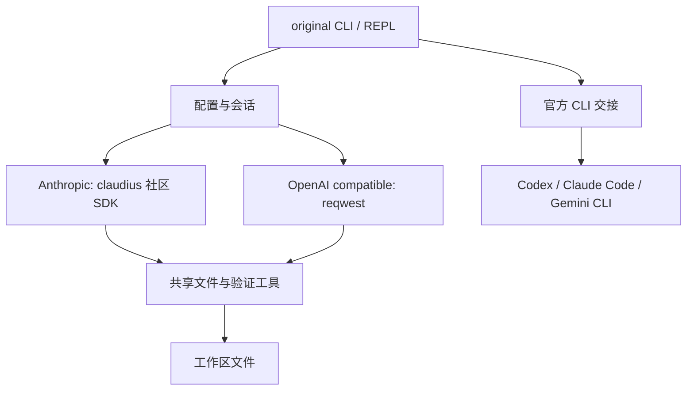

# original-agent

**简体中文** | [English](README.en.md)

Rust 编写的多厂商终端 coding agent，交互参考 [Pi](https://github.com/badlogic/pi-mono)。命令名为 `original`。


## 技术架构与 SDK

本项目是 Rust 2021 编写的独立终端应用，不是 Pi 的 Rust 官方版本，也不隶属于 Anthropic、OpenAI 或 Google。

- **运行时**：Tokio 异步运行时；Clap 解析启动参数；Rustyline 管理终端输入和快捷键。
- **Anthropic 协议**：使用社区 Rust SDK [claudius](https://github.com/rescrv/claudius)，本仓库内置版本为 0.33.0，位于 [vendor/claudius](vendor/claudius)。这是社区 SDK，**不是 Anthropic 官方 Rust SDK**。
- **SDK 本地修改**：保留 Windows 编译适配，自定义工具按不含服务端 `type` 标签的 schema 序列化，以兼容已遇到的 DeepSeek 请求问题。
- **OpenAI 兼容协议**：由 reqwest + Serde 实现 Chat Completions 与工具循环，不依赖官方 OpenAI Rust SDK；目前不提供 Responses API 后端。
- **共享编码工具**：文件读写、唯一文本编辑、批量编辑、glob、字面 grep、项目概览和验证；并提供当前进程快照、回退及本地会话归档。



| 模块 | 职责 |
| --- | --- |
| `src/main.rs`、`src/ui.rs` | 启动、输入、显示与交互验证循环 |
| `src/agent.rs`、`src/openai_client.rs` | 两种协议的模型调用 |
| `src/tools.rs`、`src/tool_dispatch.rs`、`src/fsops.rs` | 统一编码工具与文件操作 |
| `src/changes.rs`、`src/archive.rs` | 进程内改动记录与磁盘会话归档 |
| `src/subscription.rs` | 交接给已安装的官方客户端 |

## 模型兼容范围

下表描述当前代码的预设和接入路径，不代表所有模型均经过真实账号端到端测试。

| 服务 | 内置预设 / 接入方式 | 说明 |
| --- | --- | --- |
| Anthropic Claude | `claude-sonnet-4-20250514`，Messages API | `/login` 选择 Anthropic；其他模型可配置，但思考与工具参数须兼容 |
| OpenAI | `gpt-4.1`，Chat Completions | `/login` 选择 OpenAI；并非所有 OpenAI 模型均支持此协议 |
| DeepSeek | `deepseek-flash`，OpenAI / Anthropic 兼容端点 | 可自行填写其他可用模型，如 `deepseek-v4-pro`；价格与窗口需核对 |
| Grok / xAI | 自定义 OpenAI 兼容，`https://api.x.ai/v1` | 使用官方 API Key 和账号可用模型；没有内置订阅 OAuth |
| Gemini | 官方 Gemini CLI 交接 | 尚无原生 Gemini API 后端 |
| 自定义服务商 | 自定义 URL、模型、API 风格 | 需支持对应的工具调用 schema；“兼容”不保证所有扩展参数通用 |

模型价格和上下文来自代码内建对照表（公开资料快照），不会实时抓取官网。`/login` 与 `/model` 会按模型名自动填写；未知模型保留当前值并提示。官方 CLI 模式不按本项目的 API 单价计算订阅费用。

## 登录方式速查

**API 模式**：运行 `original`，输入 `/login`，选择服务商并设置 API Key、URL、模型；价格与上下文按模型自动填写。配置位于 `~/.original-agent/config.json`，密钥是本地明文。环境变量可覆盖密钥，推荐只设置当前服务商对应变量，或使用明确的 `ORIGINAL_API_KEY`；不要同时遗留多个服务商的 Key。

**官方客户端模式**：先安装对应 CLI 并加入 PATH，然后执行 `original --subscription codex`、`original --subscription claude` 或 `original --subscription gemini`。登录界面、鉴权、工具权限和额度由官方客户端负责。这只是交互式交接，**不是在 original 内直接使用订阅模型**；已有 API Key 登录不会自动变成订阅计费。本项目不获取浏览器 Cookie，也不复制官方 CLI 的认证缓存。

## 安装

无需 Rust 的安装方式（预编译 Release；本机不必安装 Rust 工具链）：


Windows PowerShell（x64）——推荐 `iex (irm …)`（整段字符串一次执行）。不要用会把脚本灌进交互提示符的粘贴/stdin 方式；旧写法 `irm … | iex` 在多数情况下也能用，但不如括号形式稳妥：

```powershell
iex (irm https://raw.githubusercontent.com/haoranyoung09-sys/original-agent/main/scripts/install.ps1)
```

固定版本：

```powershell
& ([scriptblock]::Create((irm https://raw.githubusercontent.com/haoranyoung09-sys/original-agent/main/scripts/install.ps1))) -Version v0.3.5
```

不经过 `iex` 的备用（先下载再 `-File`）：

```powershell
Invoke-WebRequest -UseBasicParsing -Uri https://raw.githubusercontent.com/haoranyoung09-sys/original-agent/main/scripts/install.ps1 -OutFile $env:TEMP\original-install.ps1
powershell -NoProfile -ExecutionPolicy Bypass -File $env:TEMP\original-install.ps1
```

Release 尚未发布时，可用仓库里已构建的二进制（需先 `cargo build --locked --release`）：

```powershell
powershell -NoProfile -ExecutionPolicy Bypass -File .\scripts\install-from-local-build.ps1
```

也可打包成假 Release 目录再走校验安装：`.\scripts\package-local-release.ps1` 后 `.\scripts\install.ps1 -BaseUrl .\dist\local-release`。

Linux x64 / macOS Intel、Apple Silicon：

```sh
curl -fsSL https://raw.githubusercontent.com/haoranyoung09-sys/original-agent/main/scripts/install.sh | sh
# 固定版本：下载脚本后
sh install.sh v0.3.5
```

脚本下载 GitHub Release 附件并校验 SHA-256。Windows 安装到 `%USERPROFILE%\.original-agent\bin` 并写入用户 PATH；Unix 安装到 `~/.local/bin`，若尚未在 PATH 会打印 `export` 提示。Linux 构建基于 Ubuntu 22.04（需兼容 glibc）。更新时重复安装命令即可。

维护者发布：推送与 Cargo.toml 版本相同的标签（如 `v0.3.5`）；Release 工作流构建四个平台并附带 `.sha256`。脚本只做完整性校验，不提供独立代码签名。首次 Release 完成前远程安装会失败，不会覆盖已有安装。离线/自测可用 `-BaseUrl` / `ORIGINAL_INSTALL_BASE` 指向本地假 Release 目录，详见 [无 Rust 安装归档](docs/archive/2026-11-05-no-rust-install.md)。

### 从源码安装

需要稳定版 Rust 工具链及平台编译工具。仓库发布后可用一条命令从源码安装：

```sh
cargo install --locked --git https://github.com/haoranyoung09-sys/original-agent.git original-agent
original
```

本地仓库安装：`cargo install --locked --path . --force`。也可执行 Windows 的 `scripts/install-original.ps1` 或 Unix 的 `sh scripts/install-original.sh`。确保 Cargo bin 目录在 PATH 中。尚未发布到 crates.io。

## 使用

先运行 `original`，输入 `/login` 配置服务商、模型和 API Key。配置保存在 `~/.original-agent/config.json`。可通过 `ORIGINAL_API_KEY` 覆盖密钥；用户配置目录中的 `.env` 可加载，项目目录的 `.env` 不会自动加载。

```sh
original --cwd /path/to/project
original -p "解释项目结构"
original --allow-shell
```

默认允许工作区文件读写，禁止 Shell。`--allow-shell` 允许模型以你的用户权限执行任意命令。请先阅读 [安全边界](SECURITY.md)。

| 操作 | 用途 |
| --- | --- |
| `/login` | 服务商、Key、URL、模型（价格/上下文自动） |
| `/model <name>` | 切换模型（自动套用公开定价与上下文） |
| `/status` | 模型、用量、费用估算 |
| Shift+Tab | low 青色 → medium 黄色 → high 紫色 |
| `/clear` | 清除当前对话；保留累计用量 |
| `/help`、`/exit` | 帮助、退出 |

### Vibe coding 工具

自然语言改代码时，模型可调用（两端后端共用 schema）：

| 工具 | 用途 |
| --- | --- |
| `project_overview` | 项目类型、浅层目录树、README 摘要 |
| `glob` / `grep` | 无 shell 的文件发现与内容搜索 |
| `read` / `edit` / `write` | 读、单处替换、整文件写 |
| `multi_edit` | 跨文件多处唯一替换（先校验再写入） |
| `verify` | 改后测试/构建回灌（需 `--allow-shell`，否则只给建议命令） |
| `bash` | 任意命令（需 `--allow-shell`） |

文件工具不出工作区；默认禁止 shell。详见 [SECURITY.md](SECURITY.md)。

输入区采用连续上下横线，中间输入，底部显示“模型名 · 思考强度”。Shift+Tab 原位重绘，不追加提示行；设置 `NO_COLOR` 可禁用颜色。OpenAI 兼容后端尚未发送 reasoning_effort，颜色表示 UI 选择，不代表所有模型都支持该参数。

## 模型默认值

价格单位为 USD / 1M tokens，核对日期 2026-11-06。实际账单以服务商为准。

| 模型 | 上下文 | 输入 | 输出 |
| --- | ---: | ---: | ---: |
| Claude Sonnet 4 | 200,000 | 3 | 15 |
| GPT-4.1 | 1,047,576 | 2 | 8 |
| DeepSeek Flash | 1,000,000 | 0.30 | 1.20 |

DeepSeek 使用峰值费率估算，非高峰费率减半。缓存折扣等可能未完整计入。自定义/未知模型不会卡住登录，但费用估算可能为空或不准；可在对照表中补充。[官方资料与审查归档](docs/archive/2026-11-05-review.md)。

## 开发

```sh
cargo fmt --check
cargo test --locked
cargo clippy --locked --all-targets
cargo build --locked --release
# 无 Rust 安装脚本（本地 fixture，不访问 GitHub）
powershell -NoProfile -ExecutionPolicy Bypass -File scripts/test-installer.ps1   # Windows
sh scripts/test-installer.sh                                                   # Linux/macOS
```

GitHub CI 覆盖 Windows、Linux、macOS（含 installer fixture job）。源码位于 `src/`；vendored SDK 位于 `vendor/claudius/`。本次修改、验证范围及未解决限制归档于 `docs/archive/`（含 [vibe coding 拓展与检验](docs/archive/2026-11-05-vibe-coding.md)）。

[贡献指南](CONTRIBUTING.md) · [安全说明](SECURITY.md) · [MIT 许可证](LICENSE) · [第三方声明](THIRD_PARTY_NOTICES.md)


## 官方客户端订阅入口（第一阶段）

先安装官方 Codex CLI、Claude Code 或 Gemini CLI，并确保它们位于 PATH：

```sh
original --subscription codex
original --subscription claude
original --subscription gemini
original --subscription codex --cwd /path/to/project
```

这些命令将终端交给官方客户端；通过其官方登录界面选择账号。当前不是 original 输入框内的统一订阅后端，不迁移对话、不复制 OAuth 凭据，也不读取浏览器 Cookie。权限与工具执行由官方客户端控制，original 的 --allow-shell 不适用于这个模式。现有客户端若已使用 API Key 登录，启动不会自动切成订阅计费；请在客户端确认登录方式与实际额度。此模式不加载 original 的 .env，但继承当前终端环境。

Grok 官方订阅接入尚未确认，`--subscription grok` 明确返回不支持；官方 API 可以通过自定义 OpenAI 兼容配置接入 https://api.x.ai/v1，模型与计费以 xAI 控制台为准。

来源：https://learn.chatgpt.com/docs/auth?surface=cli 、https://code.claude.com/docs/en/headless 、https://geminicli.com/docs/get-started/authentication/ 、https://docs.x.ai/developers/quickstart 。

## 改动回退与验证循环

- `/diff`：按修改批次查看当前进程记录的全文替换 diff（不是最小上下文 diff）。
- `/undo`、`/undo all`：回退最近一次文件工具修改或本次进程全部记录；文件已被其他程序修改时拒绝回退。
- 在可信项目中使用 `original --auto-verify` 运行内置项目测试命令。项目测试会执行仓库代码。交互模式最多追加三轮修复，单次模式只验证一次。通用 shell 需单独开启。

当前限制：快照仅保存在内存，退出即丢失；不覆盖 Shell/官方 CLI 造成的改动。批量写失败会尝试恢复，恢复失败会报告，不保证断电原子性。撤销遇到中途 I/O 错误可能部分完成。自动验证仍沿用 --allow-shell，尚未实现独立验证权限；一次性 -p 模式暂不自动验证。项目测试可执行任意代码，只对可信仓库启用。

## 本地会话归档

默认在 `~/.original-agent/sessions/<时间戳-ID>/` 保存 metadata.json 和 events.jsonl。`/sessions` 列出当前项目记录，`/session show <id>` 查看，`/export` 将当前记录导出为同目录 summary.md。`original --no-record` 关闭本次记录。官方 CLI 交接模式不归档。

当前记录用户消息、已完成轮次的对话/工具消息、错误与自动验证输出；不是每个工具完成即落盘，崩溃可能丢失进行中的轮次。登录表单不记录，过滤已知配置密钥和认证行，但任意文本中的其他秘密无法保证识别。记录可能含源代码与命令输出。暂不提供恢复对话、恢复快照、自动保留期限与删除命令，可退出程序后手动删除指定会话目录。关闭归档不等于关闭已有命令行输入历史。

## 执行状态显示

`original --show-thinking --command-timeout 120`：可选显示服务商返回的思考文本（轮次完成后，非流式）；命令超时上限 1–600 秒，不影响 HTTP 超时。Anthropic 工具显示指令/路径、耗时和成功/失败背景色；两种后端的 Shell 命令按退出码着色。OpenAI 普通文件工具仍是中性结果文字。NO_COLOR 或非终端输出禁用颜色。未进行付费 API 测试。
